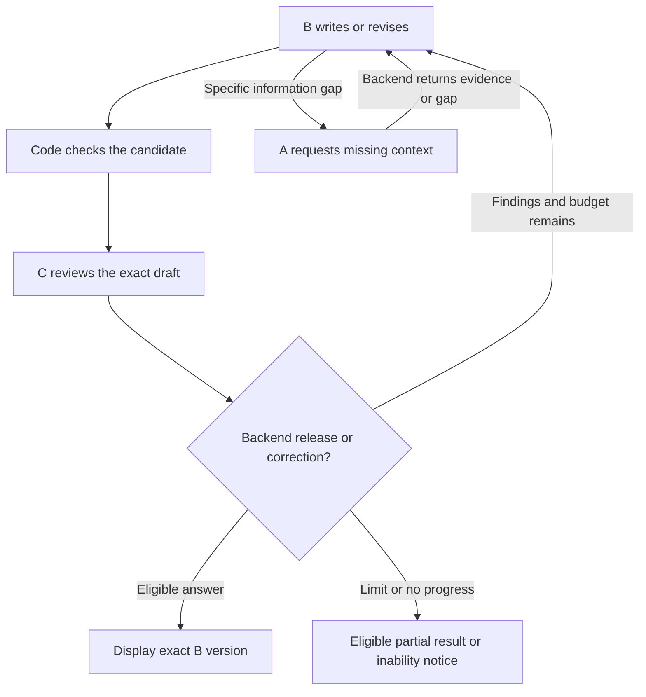

# Initial architecture 

**Status:** Design summary of SRS v0.9.1; implementation has not started.  
**Detailed reference:** [Software Requirements Specification](requirements/wireless-assistant-srs.md)

## Two different times

**Before questions:** acquire the selected documents, preserve sections and source identities, split them into useful passages, and prepare the local search index. Publish the exact covered specification and version inventory.

**During a question:** search that prepared collection and selected conversation history. Do not download a new standard on every request. Cloud model calls still require network access.

## From the user's question to the displayed answer

1. The backend records the original message and selects recent relevant context. Cheap domain clues assist the check; they cannot reject a meaningful follow-up only because it lacks a wireless keyword.
2. A resolves the user's need using the question, history and clarification replies. If an essential detail is missing, it asks a focused question and pauses. Clearly unrelated requests receive a scope explanation.
3. A requests the relevant 3GPP passages and older history when needed. Backend tools execute those searches and return original evidence with source identities.
4. B writes an answer covering the need, with citations, conditions, examples when requested, and specific limitations.
5. Code validates the records and source references. C reviews the exact B draft against the need and evidence.
6. The backend releases the eligible B version, routes findings to B within the shared limits, or stops with a checked partial result or a clear inability notice.

A citation identifier being valid is not proof that the passage supports the claim. C's review and later human evaluation address meaning and support.

## The correction loop

The diagram summarizes valid role outputs. Malformed records use bounded format repair; they cannot bypass review. All calls and searches are controlled by backend code.

With enough context, the review path is **C → B → C**. Only a specific missing-information request from B causes **C → B → A → B → C**. C cannot directly send A on another search.

## Responsibility boundaries

| Component | Allowed output | Important boundary |
| --- | --- | --- |
| A | Need record, relevant original evidence/history, or clarification | Does not write the final technical answer |
| B | Versioned answer, justified revision or specific missing-information request | Cannot approve its own answer |
| C | Review status and evidence-based findings | Cannot rewrite or directly retrieve |
| Backend | Validated transitions, tool results and final delivery | Cannot infer technical truth from format checks alone |
| Interface | Progress, clarification, eligible answer and sources | Does not display internal drafts as the final answer |

A, B and C are roles, not a promise to use three different providers. Model and framework choices remain in [issue #5](https://github.com/Yuvraj-arch79/wireless-assistant/issues/5).

## Stopping and preserving good content

There is one initial draft and at most two correction rounds. Sending C's findings to B starts a round even if the wording remains unchanged. Searches, format repairs and retries share finite budgets; they do not reset the correction count.

Every B version is retained. B changes only parts justified by evidence and the user need; C checks for lost correct content. B can explain an evidence-backed disagreement, but cannot override a failed review. These controls reduce harmful revisions without guaranteeing perfect model judgment.

Approval is tied to the exact answer, need and evidence versions. An earlier candidate is reusable only if it is still eligible for the current need. When nothing is eligible, code may display an operational inability notice; it cannot release an unchecked technical draft.

## Context and records

Keep original messages locally and use recent relevant context first. Older-history retrieval is on demand; summaries help selection but do not replace the original evidence.

The planned records include request/need IDs, source and corpus versions, selected history, B draft IDs, C findings, usage budgets and terminal status. Provider data handling, retention, backup and deletion settings require explicit decisions before real-user data is used.

## Technology status

No application framework, vector store or model provider is selected by this document. The next step is to resolve the [decision register](decisions.md), then build the [evidence foundation](https://github.com/Yuvraj-arch79/wireless-assistant/issues/7).
