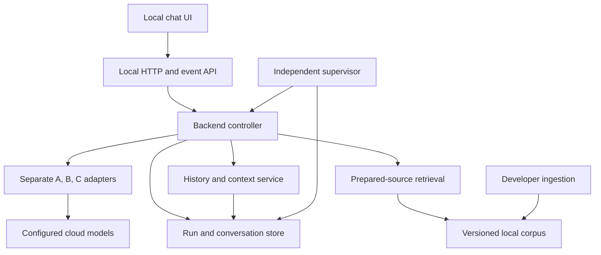

# Implementation handoff

**Baseline:** DESIGN-LLD-001 / 0.1, aligned with SRS 0.9.1.

This is the entry point for an engineer implementing Wireless Assistant. Read the [product brief](../product-brief.md), then the [architecture overview](../architecture.md), [system design](system-design.md), and this guide. The [schema](schema.sql) specifies storage; [limits](limits.example.json) are provisional development settings; [verification](verification.md) contains requirement coverage and acceptance scenarios. These files form one design set. They do not claim a working chatbot or measured production readiness.

## 1. Boundaries and component connections

The first release has a local browser UI and backend, a local conversation store and prepared corpus, developer-only ingestion, and configured free cloud model/embedding services. External network access is limited to configured providers during questions. Corpus acquisition is a separate maintainer operation. Conversations never enter the technical corpus.



Arrows identify permitted dependencies, not unrestricted model permissions. The UI never calls a cloud provider directly. Role C has no retrieval or writer capability. Storage access goes through backend repositories; model text never becomes SQL or an arbitrary tool call.

| Connection | Request data | Result data | Owner of validation/failure |
| --- | --- | --- | --- |
| UI → HTTP | Session ID, command, body, idempotency key, expected version where needed | Receipt, safe error or current resource | HTTP validates origin, body, size and command identity |
| HTTP → controller | Validated command and persisted message/run identity | Run/status identity; asynchronous work accepted once | Controller performs atomic admission and capacity check |
| Controller → configuration | Required role/corpus/config versions | Immutable, validated configuration snapshot | Configuration service rejects missing/unsafe/incompatible settings |
| Controller → context service | Session, current original message, critical replies, need and selection budget | ContextSnapshot plus exact originals and excluded-history references | Context service enforces same-session selection and context bounds |
| Controller → A | Shared envelope, originals, current need, corpus inventory, allowed actions and optional B gap | One validated A action and need proposal | Controller accepts only the current operation/epoch |
| A → backend tool dispatcher | Typed query/expansion/history request and precise purpose | Original results with stable IDs, metadata and gap/error records | Dispatcher validates scope, reserves budgets and executes allowlisted tools |
| Retrieval → embedding provider | Bounded query text and pinned compatible embedding configuration | Vector with verified model/dimension identity | Adapter accounts call/tokens/deadline; no silent model replacement |
| Retrieval → corpus indexes | Build ID, filters, query/vector, bounded candidate count | Ranked passage IDs and original text | Retrieval verifies build compatibility, scope and readability |
| Controller → B | Envelope, original need/messages, exact evidence, previous candidate/findings when revising, closing flag | Candidate, one precise missing-information request, or inability reason | B adapter validates shape; backend validates references and permission |
| B gap → A → B | Gap type, affected requirements and why it matters | Additional original context or explicit unresolved gap | Controller retains same round/counters; no broad restart |
| Candidate → code checks | Immutable candidate and source/context bindings | Pass or concrete validation errors | Validator checks structure/identity, not technical truth |
| Controller → C | Exact candidate, need, original critical messages/history, same evidence, regression context | Review decision and actionable findings | C adapter rejects rewrite/tool fields and contradictory decisions |
| C findings → B | Prior candidate, findings and allowed correction number | Revised candidate or evidence-backed disagreement | Controller increments correction round before B re-entry |
| Controller → storage/event log | Validated transition, ownership predicates and related records | Atomic commit or bounded storage failure | Repository returns success only after commit |
| Event API → UI | Ordered safe progress/wait/terminal events | Deduplicated view and committed answer | UI reconnects to status; never reruns generation implicitly |
| Source inspector → retained evidence | Run, evidence set and passage IDs | Exact source/version/clause/text used in the answer | API checks binding and session deletion state |
| Supervisor → worker/store | Lease, epoch, deadline and cancellation state | Fenced/terminated worker or degraded-capacity status | Supervisor remains responsive independently of provider execution |
| Developer ingestion → corpus activation | Validated manifest, parser/chunker/embedding settings and staging build | Validated immutable build and atomic active pointer | Ingestion isolates failure and preserves previous active collection |

The equivalent boundaries may be modules in one process initially. They do not require microservices, Kubernetes, a distributed queue, or additional cloud infrastructure. Whether workers require a separate process is a deployment choice constrained by the supervisor's ability to stop hung work.

## 2. Logical module responsibilities

These are implementation responsibilities, not empty directories to create before technology selection.

| Module | Public operations to implement | Data ownership |
| --- | --- | --- |
| Configuration | load, validate, snapshot, resolve provider/corpus settings | Immutable config snapshot; no secrets in snapshot |
| Session service | create/list/open/rename/delete, append visible messages | Sessions/messages/history index lifecycle |
| Run repository | admit, claim, compare-and-set transition, reserve operation, commit terminal, recover abandoned run | Run/epoch/version, usage ledger, command receipts and durable events |
| Context service | select recent, index excluded, search history, fetch exact ranges, pack role context | Original-message references and context snapshots |
| Orchestrator | handle A action, dispatch allowed tools, call B, validate/review, route findings, stop | State/round/budget policy; no technical answer writing |
| Role adapters | render versioned prompt, call permitted provider, parse/validate role output | Role-specific contracts and safe errors |
| Retrieval | metadata filter, semantic/exact search, merge/rank, bounded expand, freeze evidence | Retrieval records and immutable evidence sets |
| Ingestion | acquire approved sources, hash, parse, chunk, embed/reuse, validate, activate, roll back | Source manifests and immutable corpus builds |
| Release validator | check binding, decision consistency, candidate/source availability and active ownership | Release predicate only |
| Supervisor | watchdog, fence, bounded worker cleanup, startup reconciliation | Worker leases and availability; never rewrites terminal results |
| HTTP/event interface | routes in LLD section 9, local security, pagination, idempotency, SSE replay | Public DTOs and event transport |
| UI | chat lifecycle, pending clarification, progress, cancellation/retry, sources, feedback | Presentation; server remains authoritative |

## 3. Shared data dictionary

Use UTF-8 JSON at boundaries. IDs are opaque server-generated strings; timestamps are UTC ISO-8601 strings; counters are nonnegative integers; durations explicitly use milliseconds or seconds. Internal SQL `*_json` columns hold serialized versions of the records below, not arbitrary extra fields. Unknown fields and duplicate JSON keys are rejected. Optional fields are explicitly null; arrays are empty when applicable but contain no duplicate IDs. A missing required field is invalid.

| Record / field | Type and interpretation |
| --- | --- |
| OriginalRef | `{message_id: string, session_id: string, content_hash: string, start_offset: integer, end_offset: integer}`; half-open Unicode code-point range into immutable original text |
| OriginalText | `{ref: OriginalRef, role: user/assistant/clarification/notice, text: string}`; offset/hash validated against the same session |
| Requirement | `{req_id: string, description: string, mandatory: boolean, established_by: OriginalRef[]}`; stable within a need lineage |
| Scope | `{spec_numbers: string[], release: string|null, document_versions: string[], default_used: boolean}`; no silent release substitution |
| Gap | `{gap_id: string, kind: user_detail/source/history/conflict/unreadable/context_limit, requirement_ids: string[], reason: string, source_or_message_ids: string[]}` |
| Need | `{topic: string, requested_task: string, language: string, depth: string, scope: Scope, requirements: Requirement[], assumptions: string[], unresolved_gaps: Gap[], original_refs: OriginalRef[]}`; server adds need ID/version/hash |
| Passage | `{passage_id, build_id, document_id, spec_number, document_version, clause_id, content_hash, source_uri, text: string; release, clause_title, page_location: string|null; unreadable: boolean; parent_id, previous_id, next_id: string|null}`; all comma-grouped fields share the indicated type |
| EvidenceSet | `{evidence_set_id: string, run_id: string, build_id: string, evidence_hash: string, passages: Passage[], coverage_gaps: Gap[]}`; immutable, including exact text and order |
| ContextSnapshot | `{context_id: string, run_id: string, context_hash: string, originals: OriginalText[], excluded_history_refs: OriginalRef[]}`; stored references may be larger than the compact prompt map, but fetches remain bounded |
| Citation | `{marker: string, claim_anchor: string, passage_ids: string[]}`; marker is unique within the candidate; anchor is a stable paragraph/claim label; source metadata resolves from the immutable EvidenceSet |
| UnresolvedRequirement | `{req_id: string, reason: string}` |
| RevisionEntry | `{finding_id: string, disposition: changed/retained_with_evidence/unresolved, target: string, reason: string, evidence_ids: string[]}` |
| Finding | `{finding_id: string, finding_type: contradicted_claim/insufficient_support/missing_user_requirement/presentation_problem, blocking: boolean, target_claim_or_req: string, reason: string, evidence_ids: string[]}` |
| RegressionCheck | `{status: not_applicable/checked, compared_candidate_id: string|null, lost_or_changed_requirement_ids: string[], resulting_finding_ids: string[]}`; first draft requires not_applicable; revisions require checked |
| ReviewedBinding | `{candidate_id, candidate_hash, need_id, need_hash, evidence_set_id, evidence_hash, context_id, context_hash: string}`; all are backend-provided expected values |
| BudgetCounters | `{provider_calls, provider_retries, format_repairs, search_queries, history_operations, tool_operations, controller_steps, charged_tokens: integer, missing_info_by_round: integer[3]}`; active elapsed time and correction round use dedicated run columns |
| ConfigSnapshot | `{config_snapshot_id, config_hash, backend_version, contract_version, tokenizer_version, corpus_build_id: string; limits: object; roles: object; retrieval: object; prompts: object}`; role records identify provider/model/revision, input/output caps and credential reference name, never credential value |

An empty corpus inventory uses a null build reference during need/scope resolution. Before any technical retrieval/candidate, a validated build and compatible embedding configuration must exist. Domain clarification can occur without a usable corpus; technical generation cannot claim nonexistent coverage.

Hash convention for this baseline: SHA-256 of UTF-8 JSON with object keys sorted, no insignificant whitespace, arrays in recorded order, non-finite numbers rejected, and strings preserved without silent Unicode normalization. Numeric payload values included in hashes are integers; retrieval scores, if needed, are explicit decimal strings. The adapter's canonical serialization must be consistent across the implementation. A backend-assigned snapshot ID alone is insufficient if mutable content could be substituted.

The LLD calls the shared envelope's context identifier `context_snapshot_id`; it maps to `context_snapshots.context_id` and `ReviewedBinding.context_id`. Its `corpus_build_id` maps to the stored evidence `build_id`. `config_snapshot_id` is carried inside the run's immutable `config_snapshot_json`, alongside `config_hash`. These are explicit mappings, not different versions of the same input.

## 4. Role and tool action shapes

Combine the common records above with LLD section 7. Input envelopes are assembled by the backend, not inferred from previous model output. Exact original text for the current query and critical replies is always supplied to B/C. A need's requirement IDs remain traceable to those originals.

| Role action | Required action-specific fields | Excluded action-specific fields |
| --- | --- | --- |
| A / clarify | `need: Need`, `intent_relation`, `clarification: {question: string, missing_requirement_ids: string[], alternatives: string[], gap_key: string}`, `coverage_gaps: Gap[]` | requests, scope_reason |
| A / collect | `need: Need`, `intent_relation`, `requests: ToolRequest[]` (nonempty), `coverage_gaps: Gap[]` | clarification, scope_reason |
| A / ready_for_b | `need: Need`, `intent_relation`, `coverage_gaps: Gap[]` | requests, clarification, scope_reason |
| A / out_of_scope | `intent_relation`, `scope_reason: string`; `need` may be null | requests, clarification |
| B / submit_draft | `answer_markdown: string`, `citations: Citation[]`, `covered_requirements: string[]`, `unresolved_requirements: UnresolvedRequirement[]`, `limitation_statement: string|null`, `revision_log: RevisionEntry[]` | missing_info, cannot_answer_reason |
| B / request_missing_info | `missing_info: {type: source/history/user_detail, item: string, why_material: string, requirement_ids: string[]}` | answer_markdown, citations, cannot_answer_reason |
| B / cannot_answer | `cannot_answer_reason: Gap[]` (nonempty) | answer_markdown, citations, missing_info |
| C / review | `reviewed_binding: ReviewedBinding`, `decision`, `satisfied_requirements: string[]`, `unmet_requirements: string[]`, `findings: Finding[]`, `regression_check: RegressionCheck` | technical answer, rewrite, retrieval or tool fields |

Every A/B output also contains its exact `action`; A `intent_relation` is one of same_need/correction/new_topic/uncertain. C's decision enum and cross-field rules are in LLD section 7.4. “Excluded” means the field must be absent, not merely ignored. Unknown fields are rejected. Records may carry only the backend-requested envelope echo; it cannot alter backend state. On valid output, backend assigns stored candidate/review IDs and computes hashes.

A `collect` request must use one of these tagged shapes, with unknown fields rejected:

| `kind` | Required fields beyond `kind` | Result |
| --- | --- | --- |
| `corpus_search` | `purpose: string`, `requirement_ids: string[]`, `query: string`, `filters: Scope`, `limit: integer` | Original Passage[] plus query/build identity and explicit gaps |
| `expand_passages` | `purpose`, `requirement_ids`, `passage_ids: string[]`, `relation: parent/previous/next/cross_reference`, `limit: integer` | Original passages in the same pinned build, bounded by visited-set/depth limits |
| `history_search` | `purpose`, `requirement_ids`, `query: string`, `cursor: string|null`, `limit: integer` | Same-session original references/snippets plus opaque next cursor |
| `history_fetch` | `purpose`, `requirement_ids`, `refs: OriginalRef[]` | Exact validated OriginalText[] within aggregate size/context bounds |

Tool results have `{operation_id: string, status: ok/empty/limited/failed, items: array, gaps: Gap[], next_cursor: string|null, error: SafeError|null}`. The backend supplies session/build boundaries and caps requested limits. Empty results are not transport errors; duplicate queries use the recorded fingerprint/result without uncounted provider work. Each actual backend/embedding/reranking operation is separately accounted in the shared ledger. A tool error cannot be reinterpreted as successful absence of evidence.

There is no generic agent-to-agent channel. All transitions go through the controller. Prompts should state role purpose, input meanings, allowed action schema, source/history trust boundaries and limits. Prompt text is versioned with its role; production prompts and model choices must be evaluated rather than copied from an untested chat example.

## 5. UI API payloads and events

The complete endpoint list is in LLD section 9. Common success data is wrapped in `{request_id: string, data: object}`. `SafeError` is `{code: string, message: string, retryable: boolean, retry_after_seconds: integer|null}`. Error responses are `{request_id: string, error: SafeError, current_run: RunStatus|null}`. Never include keys, raw provider payloads or hidden drafts.

| Command | JSON request body | Success data |
| --- | --- | --- |
| Create session | `{title: string|null}` | Session |
| Rename session | `{title: string, expected_session_version: integer}` | Updated Session |
| Submit message | `{text: string}` | `{message_id, run_id: string, status: ACTIVE, state_version: integer}`; `202` only after transaction commits |
| Clarification reply | `{text: string, expected_run_version: integer}`; run/question IDs in route | Message/run receipt; duplicate request returns original receipt |
| Cancel | `{}` | Current RunStatus; does not falsely promise cancellation if completion already won |
| Retry | `{}` | Receipt containing new run ID and retry_of_run_id; original user message is reused |
| Delete session | No body | `204` once purge completes; `202` with tombstoned state while bounded cleanup remains; retrying DELETE reconciles cleanup |
| Feedback | `{run_id, candidate_id: string, category: wrong/unclear/irrelevant/incomplete, comment: string|null}` | `{feedback_id: string}`; server resolves exact displayed review/evidence |

Every mutation has the Idempotency-Key header. Missing key is `400`; same key/different canonical route/body is `409`. Retry is an explicit user command, never a browser reconnect action. An accepted clarification reply retains original query and all relevant critical replies on subsequent retries; rebuilding context from only the first question would be incorrect.

| Response DTO | Fields |
| --- | --- |
| Session | `session_id, title, created_at, updated_at: string; state_version: integer; active_run: RunStatus|null` |
| Message | `message_id, turn_id, content_text, created_at: string; sequence: integer; role: user/assistant/clarification/notice; run_id: string|null` |
| Page | `items: array, next_cursor: string|null`; stable cursor and bounded page size |
| RunStatus | `run_id, session_id: string; status: lifecycle enum; stage: string; state_version: integer; pending_clarification: {clarification_id, question, message_id: string}|null; outcome: Outcome|null; retryable: boolean` |
| Outcome | `kind: ACCEPTED/PARTIAL_ACCEPTED/INABILITY/OUT_OF_SCOPE/ERROR/CANCELED/TIMED_OUT/INTERRUPTED; final_message_id: string|null; candidate_id: string|null; review_id: string|null; evidence_set_id: string|null; stop_code: string|null` |
| Health | `live: boolean, storage_ready: boolean, generation_ready: boolean, safe_reasons: string[]`; provider availability is last observed, not an unbounded probe |
| CorpusStatus | `active_build_id: string|null, ready: boolean, documents: {spec_number,title,version,source_uri: string; release: string|null; status: string}[], coverage_gaps: string[]` |

`RunStatus` omits raw prompts, C findings, token-level hidden reasoning and internal candidates. A technical outcome references exactly one persisted B candidate and valid review. Nontechnical terminal outcomes may have no candidate/review. The Message DTO's run_id is resolved from run final-message/original-message links or the clarification record; it need not be duplicated in the messages table. If one original user message has multiple retry runs, its displayed run reference is the latest applicable run; attempt history remains separate.

SSE data uses `{event_id: string, run_id: string, state_version: integer, type: string, payload: object}`. Persisted `event_id` represents the run plus event sequence. `progress` carries `{stage: string, message: string}`; `clarification_required` carries the pending clarification; terminal events carry Outcome and committed message ID. The UI fetches the committed message and renders it or progressively reveals that stored checked content. Heartbeats carry status/version, do not advance processing, and need no durable ID. Support Last-Event-ID; pruned events produce resync guidance and status fetch. Apply bounded reconnect as specified in the LLD.

Synthetic submit example (identifiers are illustrative, not production IDs):

```json
{
  "request_id": "request_example",
  "data": {
    "message_id": "message_example",
    "run_id": "run_example",
    "status": "ACTIVE",
    "state_version": 0
  }
}
```

Synthetic waiting status:

```json
{
  "run_id": "run_example",
  "session_id": "session_example",
  "status": "WAITING_USER",
  "stage": "CLARIFICATION",
  "state_version": 3,
  "pending_clarification": {
    "clarification_id": "clarification_example",
    "question": "Which two procedures do you want to compare?",
    "message_id": "clarification_message_example"
  },
  "outcome": null,
  "retryable": false
}
```

## 6. Transaction and scheduling responsibilities

Implement the following as short database transactions with bounded lock waits. Do not leave a transaction open during API calls, user waiting, streaming or parsing.

| Transaction | Atomic writes and conditions |
| --- | --- |
| Admit | Check live session/capacity and idempotency receipt; insert original message and run; unique unfinished-run constraint; commit receipt and initial event |
| Reserve/dispatch | Check active ownership, current deadline and all budgets; allocate operation ID and reserve maximum cost; update counters/version; commit before provider I/O |
| Accept operation result | Match operation ID, current epoch/state and config; ignore stale/terminal results; reconcile usage conservatively; store validated immutable result |
| Enter wait | Save current need, clarification message and pending clarification; settle active time; invalidate old in-flight ownership; save waiting event and state |
| Consume reply | Validate exact pending question/version/key; save user reply; mark question answered once; claim active worker; preserve counters; store receipt/event |
| Start correction | Validate current C findings; increment correction round before B; retain candidate/findings; reserve allowed work; no direct C-to-A route |
| Finalize | Recheck complete release predicate; store final visible B text and exact candidate/review/evidence references; terminal record/event; release session ownership together |
| Cancel/interruption | Conditional transition; fence epoch; close pending clarification if applicable; stop active-time accounting; persist outcome/event; release session ownership |
| Retry | Verify retriable terminal attempt and live/free session; reuse original user-message ID and relevant reply context; new run/config snapshot and retry lineage; no automatic retry loop |
| Delete | Fence and tombstone first; reject reads/new work; purge original and derived session data; report pending/error honestly if cleanup cannot complete within bounds |
| Activate corpus | Verify fully durable validated build and expected prior pointer; atomically switch pointer; retain referenced snapshots/builds for existing answers |

The admission transaction and worker scheduling require reconciliation: a committed ACTIVE run that never receives a worker must expire through a dispatch deadline/lease and become INTERRUPTED. A process crash between commit and scheduling must not leave a permanent ACTIVE record. Persisted operations with uncertain dispatch/completion are UNKNOWN on recovery and consume conservative quota; they are not blindly replayed.

Use one explicit control loop for the documented state machine, not unconstrained autonomous agent recursion. Before each step: check cancellation/ownership, increment controller-step count, check active deadline and budgets, and select only a documented next action. Before network work: reserve allowance and clip timeout to remaining active budget. After any wait: recheck ownership/deadline before accepting the result. Shared counters have one authoritative repository, not separate allowances hidden inside each adapter.

## 7. Storage-to-contract mapping

| Stored record | Boundary record / relationship |
| --- | --- |
| sessions, messages, history_entries | Session/Message, OriginalText and searchable exact history; hidden candidates are separate |
| request_runs | RunStatus, Outcome, ConfigSnapshot, BudgetCounters, current need/evidence pointers, retry lineage, worker lease/epoch |
| needs, context_snapshots | Immutable Need and ContextSnapshot; exact originals retained by ID/hash/offset |
| clarifications | Pending gap/question and exactly one consumed reply; waiting session remains reserved |
| corpus_builds, corpus_pointer, source_documents, passages | Active inventory, source provenance, compatible indexes and original Passage |
| evidence_sets, retrieval_records | Immutable EvidenceSet; the requests/results that produced it |
| candidates, reviews | B action payload plus backend IDs/hashes; C decision bound by composite identity |
| operations | Call/tool reservation, dispatch/result state, observed usage and safe error |
| command_receipts, run_events | Idempotent command results and durable reconnectable public events |
| feedback | Exact displayed candidate/review/run linkage; evidence resolved through the candidate |

The SQL constrains core identities and selected invariants. JSON shape/coverage, source support, state-transition authorization, deletion of non-SQL indexes and atomic ledger accounting still require application code and tests. Do not copy SQL and assume those checks have been implemented.

## 8. Implementation sequence and acceptance gates

| Step | Build / decision | Gate before continuing |
| --- | --- | --- |
| 1 | Resolve initial inventory/default release (#4), benchmark role APIs/retrieval/parser/store/framework (#5), record relevant baseline decisions (#6) | Versioned decision evidence; no guessed provider or corpus choice |
| 2 | Configuration validation, database migration/repositories, synthetic role adapters, state controller, supervisor and bounded scheduling | Fault tests for admission, wait/reply, timeout, cancel, restart, duplicate/late result and storage errors; no real model needed for control tests |
| 3 | Developer ingestion, compatible indexes, retrieval and inspectable original evidence (#7) | Verified reference clauses/tables and source versions; safe activation/rollback |
| 4 | Context/history, A/B adapters and local UI/API lifecycle | Exact need/critical replies preserved; context bounded; citations inspectable; internal development only |
| 5 | C review, correction/no-progress/closing logic and exact-version delivery | No failed/unchecked answer released; regression controls and finite limits pass |
| 6 | Real-provider integration, privacy/security, capacity/latency and held-out domain evaluation | Recorded T01–T30 and F01–F24 results, configuration versions and accepted limitations |
| 7 | Reproducible startup/setup docs, rollout and rollback | Owner/domain review of release evidence; supported scope/platform and retention disclosed |

SRS stages remain M1–M6; these steps break those stages into implementation dependencies rather than create new milestones. Synthetic control tests may be developed while data/provider decisions are open. Production integration must wait for the decisions it depends on.

No arbitrary speed/accuracy guarantee is introduced. Record observed latency by stage/outcome, retrieval support, C false acceptance/objection, harmful revisions, token/call usage and hardware/corpus/provider versions. Keep held-out evaluation separate from prompt tuning. Store evidence of failures and rollback instructions before expanding the corpus.

## 9. Definition of a complete implementation handoff

The design set documents scope, component ownership/connections, exact shared record meanings, role/tool action contracts, public API payloads, persisted relationships, state transitions, budgets, security boundaries, failure behavior, UI outcomes, dependency order and acceptance mapping. Open choices are visible in the decision register and issues #4–#6, with an owner and required stage.

The remaining model/corpus/stack choices are implementation prerequisites, not missing decisions to silently fill with guesses. Record each selected choice and its evidence before coding the dependent integration. Keep this handoff and its LLD/schema/tests consistent when any contract changes; regenerate the SRS PDF only if the SRS itself changes.
