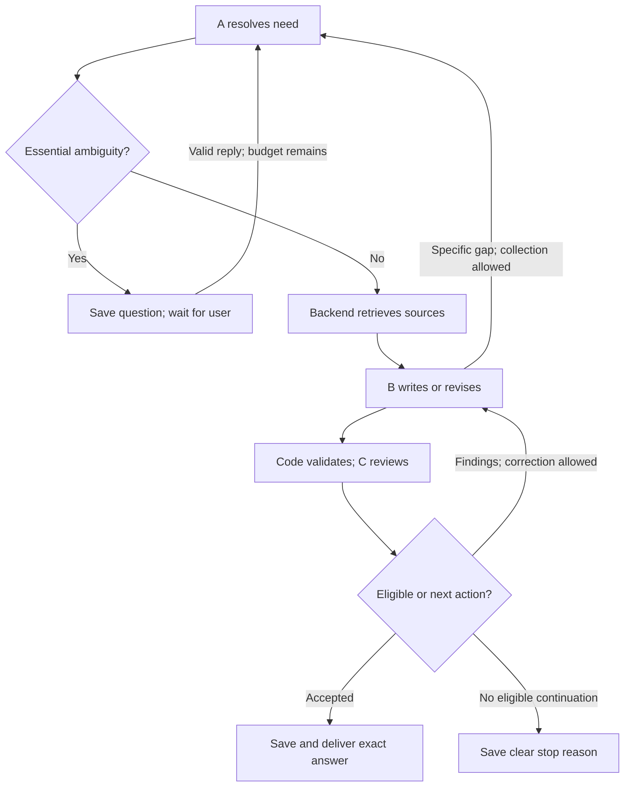

# Wireless Assistant — system design and low-level design

| Document control | Value |
| --- | --- |
| ID / revision | DESIGN-LLD-001 / 0.1 |
| Date | 23 October 2026 |
| Status | Design reference; v0.1.0 prototype implemented, full release acceptance pending; see [runtime verification](../implementation/verification.md) |
| Requirements | [SRS 0.9.1](../requirements/wireless-assistant-srs.md), 94 requirements, T01–T30 |
| Upstream basis | `3109b11170784a71ac3d21131700277b5ffdee93` |
| Supporting specifications | [Implementation handoff and connection contracts](implementation-guide.md), [relational schema](schema.sql), [development limits](limits.example.json), [coverage and acceptance checks](verification.md) |

## 1. Product overview and authority

The assistant helps users understand, locate, compare and verify information in a declared, developer-prepared 3GPP cellular collection. It preserves conversational context and adapts to the user's requested language, depth, examples and format. It is a localhost application using permitted free cloud APIs. It neither trains a model nor requires a local generative model. Runtime questions do not download standards or search the web. End users do not upload or manage the corpus.

The five problems in the [product brief](../product-brief.md) remain the product basis. A collects context; B alone writes technical answers; C reviews; backend code owns tool execution, states, budgets, persistence and delivery. A/B/C are responsibilities and need not use different providers. Their agreement is not proof of truth.

This design implements the SRS and the owner's recorded clarifications. Another useful clarification is permitted when essential meaning remains unclear; a previous question is never a reason to force a guessed answer. Design publication is not production acceptance, proof of perfect model judgment, or evidence of measured performance.

The [12-document development source inventory and acquisition tool](../../corpus/README.md) are available as of 24 October 2026. Domain/default-release review, frameworks, model providers, retrieval implementation and operating values remain subject to [D01–D11](../decisions.md). SQLite DDL is an executable reference data design, not a benchmark-backed final stack selection. FastAPI, BM25/FTS, vector stores and RRF remain candidates. A selected implementation must preserve the behavior below even if its technology differs.

## 2. Components and end-to-end flow

| Component | Responsibility and boundary |
| --- | --- |
| Local UI | Saved chats, input, progress, clarification, checked answers, source inspection, cancel/retry, feedback |
| HTTP service | Validate input, local access, idempotency and session ownership; acknowledge accepted work |
| Orchestrator | Deterministic transitions, version checks, quotas, counters, deadlines and terminal commit |
| Context service | Original messages, selected recent context, linked history index and exact back-fetch |
| Role adapters | Separate A/B/C prompts and validated records; no unrestricted model tool execution |
| Retrieval service | Prepared corpus search, filters, exact/semantic retrieval and bounded source expansion |
| Corpus maintainer | Offline acquisition, parsing, validation, staging, activation and rollback |
| Persistence | Messages, immutable versions, activity ledger, events, feedback and recovery records |
| Supervisor | Detect expired workers independently of a blocked provider call; fence abandoned workers |

1. Validate the input and session. Atomically save one user message and claim one run. Pin configuration and a compatible corpus snapshot. Return the run ID promptly.
2. Load bounded relevant context. Cheap vocabulary clues assist A; they cannot reject a valid short follow-up merely because it lacks a cellular keyword.
3. A uses the original question, history and corrections to resolve the need. Essential ambiguity produces a focused clarification and a persisted waiting state. Clearly unrelated requests produce a short scope notice.
4. Backend executes A's eligible history/evidence requests. A's summary is not technical evidence. Original retrieved passages, identities, conditions and known gaps reach B and C.
5. B writes a candidate or identifies a precise missing item. Code validates its structure and references; C reviews the exact immutable candidate against the need and evidence.
6. An eligible full or partial answer completes immediately. Otherwise C's actionable findings go to B. Only B's precise missing-information request permits another A collection step. All paths share the remaining run budget.
7. Save an eligible answer or operational terminal notice before delivery. A failed or unchecked draft never becomes a fallback answer.

The diagram omits error edges for readability. Every active node has the cancellation, timeout, failure and recovery transitions in section 3.

## 3. Run lifecycle, concurrency and recovery

### 3.1 Persistent state

States are `ACTIVE`, `WAITING_USER`, `COMPLETED`, `CANCELED`, `FAILED`, `TIMED_OUT`, and `INTERRUPTED`. The last five are terminal. `stage` distinguishes need resolution, history, retrieval, drafting, validation, reviewing and finalizing while active. Waiting is a durable state with no running model/tool work and no database transaction or worker slot held open.

Every run carries a server-generated ID, session ID, original user message ID, attempt lineage, current need/evidence versions, configuration snapshot, monotonically increasing state version and worker epoch. Clients and models cannot set budgets or assign authoritative run/draft/review IDs.

| From / event | Guard | Action / next state |
| --- | --- | --- |
| Idle / submit | Session exists, valid body, new idempotency key, capacity available | In one transaction save message and run; claim session; `ACTIVE` |
| Any / duplicate submission | Same key and same canonical payload | Return existing message/run; do not start work again |
| Any / reused key with different payload | Payload hash mismatch | Reject `409`; do not reinterpret as a retry |
| Active / second dependent submission | Session already has an unfinished run | Reject `409`; UI offers Wait or Stop; no queue |
| Active / clarification | Recorded essential gap, remaining processing budget | Persist pending clarification and event; cancel dependent work; account active time; fence/release worker; `WAITING_USER` |
| Waiting / reply | Correct pending clarification ID, session, state version and fresh idempotency key | Save reply, consume that clarification once, claim a worker atomically, preserve counters; `ACTIVE` |
| Waiting / duplicate or old reply | Already consumed or version mismatch | Return prior receipt for duplicate; otherwise `409` with current status |
| Waiting / unrelated new question | Explicit Stop/new request, or A detects changed intent after reply | Cancel/supersede old attempt; preserve the message; create a linked new need/attempt only for the new user intention |
| Active / valid approval | All release predicates in section 7 pass | Commit exact final message, terminal record, event and unlock together; `COMPLETED` |
| Active / scope or verified inability to continue | Recorded scope/gap reason | Commit operational notice and unlock; `COMPLETED` with appropriate outcome |
| Active or waiting / cancel | Run still unfinished | Atomically fence worker, mark canceled, resolve pending question, unlock and emit event; `CANCELED` |
| Active / deadline exhausted | Deadline or any hard budget prevents further work | No new calls; terminal timeout/limit notice and unlock; `TIMED_OUT` or `COMPLETED:INABILITY` as appropriate |
| Active / unrecoverable failure | Retry/repair unavailable or error is permanent | Save distinct error and unlock; `FAILED` |
| Active / worker lost or restart | Prior epoch is abandoned | Fence old results, mark `INTERRUPTED`, clear session ownership; explicit retry only |
| Waiting / normal restart | Pending clarification still exists | Remain waiting and show its saved question; do not start processing automatically |
| Terminal / late callback | Any terminal state or epoch mismatch | Discard callback for publication; do not resurrect run/session |
| Failed, timed out, interrupted, canceled, or retriable inability / explicit retry | Original message retained; session free; current capacity/quota allow | Create a new bounded run linked by `retry_of_run_id`; keep original message bubble; previous run remains terminal |
| Any / delete session | Valid local request | Fence active work and tombstone session first; purge all linked history and derived data; late callbacks cannot recreate it |

Claim/reply/cancel/finalization use short transactions and compare-and-set conditions on state version and worker epoch. A unique unfinished-run constraint is the final defense against double-click/two-tab races. Never hold a database transaction across a network call. Database lock waits and retries also have finite limits.

Completion and cancellation may race. The first valid terminal commit wins. A cancel arriving after committed completion returns the current completed status; it does not claim to have canceled it. Clearing a lock is conditional on ownership so an old worker cannot unlock a newer run.

### 3.2 Reply and wait semantics

Ask only for an essential missing detail after checking available context. Name the ambiguity and provide useful alternatives where known: “I could not tell which two procedures you mean. Please give their names or identify the earlier message.” Optional details do not force questioning.

There is no fixed one-clarification-per-question limit. Each clarification needs a concrete unresolved item. Persist its ID, need version, missing requirement IDs and known alternatives. A substantive reply may justify another focused question; it never authorizes an autonomous question/reply loop.

If a reply does not resolve or narrow the same gap, stop repeating the same question. Save a clear waiting message explaining the required name/example. Every later user reply is handled once under the remaining budget. Exact duplicate submissions are deduplicated. The waiting screen stays usable for another detail, Stop, a new chat, or deletion.

Active time, model calls, searches, corrections and retries do not reset on clarification. Human waiting time does not consume active-processing time. No open provider request, worker slot, busy polling or loading spinner continues during the wait. A run that has exhausted its processing allowance ends with the specific missing information and explicit continuation/retry guidance. A subsequent user-triggered attempt is linked and bounded; backend code never creates unlimited fresh attempts for itself.

A correction to the need creates an immutable new need version and invalidates approvals for the previous need. Keep the correction count and resource ledger. A genuinely new topic is a new user intention and uses the supersession path above.

### 3.3 Restart, disconnect and unhealthy backend

Persist original messages, waiting prompts and terminal results. Never report successful storage before the transaction commits. Disk-full/corruption errors disable further generation and expose a storage error; do not pretend the conversation was saved.

Worker ownership has a lease/heartbeat and epoch. An independent supervisor expires abandoned active work and releases capacity; provider calls and parsers must be interruptible or isolated so a blocked task cannot prevent the supervisor and cancel endpoint from responding. A lost worker is not silently replayed because a provider may already have executed its call.

Fencing prevents stale publication but does not itself terminate a hung process. Reclaim a worker slot only after bounded cleanup confirms the worker has stopped; if cleanup fails, mark that capacity unavailable and reject new work rather than accumulate orphan workers. A remote provider may finish a request after local cancellation; ignore its result and retain conservative usage accounting. Local cancellation must not wait indefinitely for remote acknowledgment.

The browser has submission, heartbeat and reconnect deadlines. A disconnected stream triggers bounded status reconciliation, not a new generation request. After reconnect attempts expire, replace the spinner with “Connection lost; status unavailable” and an explicit refresh/status action. A server outage cannot promise a persisted terminal result while the server is down. On recovery, reconcile saved status before showing completion or enabling a new dependent run.

## 4. Finite processing and resource accounting

### 4.1 Hard limits

[limits.example.json](limits.example.json) supplies clearly labeled development values. These are conservative examples to exercise the design, not approved latency targets or provider benchmarks. Runtime configuration must reject zero/unbounded/negative limits, missing limits, incompatible model contexts and a closing reserve larger than the total allowance.

| Bound | What is counted |
| --- | --- |
| Active-processing deadline | Context loading, database/tool waits, API calls, validation, retry backoff and finalization; excludes durable user waiting |
| Per-operation deadline | Every provider call, retrieval/history operation, database wait, parser and bounded retry delay |
| Provider-call budget | A/B/C, embedding, reranking, network retries and model format repairs; SDK hidden retries must be disabled or counted |
| Token budget | Inputs, reserved maximum outputs and provider reasoning tokens where applicable; conservative charge when actual usage is unknown |
| Search/tool budgets | Each requested query and each actual backend operation; a query array, parallel retrieval, neighbors or pages cannot bypass limits |
| Controller-step budget | Every internal transition/re-entry; catches unexpected loops even without model calls |
| Correction budget | Initial candidate plus at most two C-to-B feedback rounds; unchanged answers still consume a round |
| Repair/retry budgets | Shared finite limits across roles and nested calls; permanent errors have no automatic retry |
| Data bounds | Input bytes/tokens, result count/bytes, context, output, expansion depth, event buffers and queue/capacity bounds |

Reserve a call and its maximum token cost atomically before dispatch, including concurrent calls. Charge failures conservatively. Reconcile unused reservations only when provider usage is reliable; never refund an uncertain call merely because it timed out. Track active monotonic elapsed time and persisted cumulative elapsed time. Crash recovery terminates the attempt rather than assuming its unrecorded time was free. Check deadlines again before accepting results and committing completion.

The current run deadline clips every inner timeout and retry delay. A provider `Retry-After` that does not fit causes a clear rate-limit result; it is not a reason to wait indefinitely. Cap global active workers and provider concurrency as well as each session. When full, reject with a clear busy response; no unbounded queue across many chats.

### 4.2 Closing reserve and loop exit

Before optional collection, reserve capacity for one allowed B candidate and its C review: two model calls, their input/output token ceilings, timeouts and bounded persistence time. Calculate this against the actual role configuration and planned payloads. A reserve is an opportunity to attempt closure, not a promise that an unavailable provider will answer.

When remaining resources approach that reserve, stop optional searches and enter `closing_mode`. B uses available supporting evidence, removes unsupported assertions, and states limitations. This candidate consumes the next allowed draft/correction slot. There is no fourth draft or extra post-review cleanup.

During normal drafting B may make at most one missing-information request per round. It may identify a source, history or essential user gap; collection routes through A and returns to the same B round. During closing, no new collection is launched. An unresolved essential user ambiguity must instead produce a recorded information-needed notice; it cannot be guessed away. The user can provide that detail in an explicit linked continuation attempt.

After the first failed review, start correction 1 only if resources permit. After the second failed review, compare requirement-linked blocking issues, evidence changes and the revision log. Unchanged unresolved issues with no useful progress stop optional collection. If a remaining allowed closing candidate can produce a useful supported partial, attempt it; otherwise issue inability. Compare structured issue targets, not exact wording or model confidence. A changed paraphrase of the same objection is not progress. The third failed review ends the run.

Any repeated request without a new action, empty action list, or contradictory role action is an invalid contract, not permission for another open-ended loop. Use the remaining bounded repair path or stop. Cancellation and hard exhaustion always outrank optional closing work.

### 4.3 Termination argument and its limits

Every autonomous cycle consumes the finite controller-step budget; every external wait has a deadline clipped to the remaining active budget. Calls, retries, searches and correction counters are monotonic within a run. The only wait without an active deadline is `WAITING_USER`, which executes no autonomous work. Therefore the specified controller cannot generate an unlimited autonomous cycle if these guards and the supervisor are correctly implemented.

This is a design property, not proof of a future implementation. A hung OS, stopped browser, power failure or unavailable database needs recovery handling and cannot be turned into a guaranteed live answer. Fault-injection tests must verify the concrete implementation.

## 5. Conversation context and exact history

Store every original user message and displayed assistant/clarification message in order. Internal drafts never enter the visible conversation. A logical turn may contain several clarification messages; four turns do not necessarily equal eight messages.

The recent-context token budget is a hard selection budget. Prefer relevant recent complete turns that fit. The previous complete turn is not guaranteed to fit. Do not silently truncate it or drop an essential current query/critical reply. Include a stable reference and retrieve the needed original range if it is too large.

Maintain a deterministic history address index for all saved messages, including early turns, long turns, clarification-only turns and failed/canceled interactions. The index carries message IDs, order, topic/need metadata, exact text offsets and available citation metadata; it is not an invented narrative summary. No extra LLM summarization call is required per message.

Build the prompt's compact history map from messages actually excluded from the selected context, even when the session has fewer than four turns. Avoid duplicating selected text. An 800-token map is a development bound, not a promise to fit 25 turns. Entries omitted from that compact map remain searchable in the complete local index, with a paginated, bounded history-search operation. Failed metadata extraction must leave a searchable message ID and original text, not erase the entry.

Exact back-fetch retains session, message ID, version/hash and offsets. A reference such as “third point” is resolved from the original list, not a generated recap. If multiple candidates remain plausible, clarify. Retrieval from chat identifies the user's intent; it does not establish 3GPP technical truth. New user corrections override old conflicting preferences and invalidate affected derived context.

Before each role call, pack system instructions, exact current question, critical replies, need, relevant original history, evidence, previous candidate/review where required, and output allowance into that role's supported context. Drop optional material first. Bound total back-fetch and evidence size. If mandatory material cannot fit, explain the limit and request a narrower task or use a supported configured model; never silently discard essential constraints or switch to a paid provider.

## 6. Corpus ingestion and retrieval

The developer selects and records exact specifications, releases, versions, official source locations and expected question types before ingestion. A corpus badge exposes that inventory read-only. Do not present a release or specification as covered merely because its name occurs in a prompt.

Ingestion validates file types, sizes, page/resource bounds and parse errors in an isolated bounded job. Preserve clause numbers, headings, tables, merged headers, notes, definitions, cross-references, page locations and source provenance. Mark unreadable/incomplete material; exclude it from direct technical support. A readable neighboring paragraph does not make an unreadable normative table usable.

Split at meaningful boundaries and preserve parent/neighbor links. Chunk targets such as 800 tokens are development settings, not permission to separate a condition from its result. Expansion has item, depth, byte and time bounds; visited IDs prevent cyclic cross-reference traversal.

Reuse unchanged parsing/embedding work using content hashes and compatible configuration. The build fingerprint includes source manifests, parser and normalization versions, chunking configuration, embedding provider/model/revision/dimensions and retrieval/index format. A changed parser/configuration may require a new build even if the PDF hash is unchanged; unchanged exact chunks can still reuse compatible embeddings.

Build metadata, text, lexical and vector indexes under a new immutable build ID. Validate source links, counts, structure samples, vector dimensions and representative retrieval. Activate the entire build through one committed pointer after all components are durable. Retain a valid prior build for rollback. A crash before activation leaves the old build active; orphan staging data is cleaned by bounded maintenance.

Pin each run to a corpus build and compatible query embedding configuration. Corpus activation during a run does not silently change its sources. Retain referenced build passages or equivalent immutable evidence snapshots for saved citations. Garbage collection must not break source inspection for retained answers. New runs use the new build; compatible-cache checks include the build and configuration versions.

Runtime retrieval applies explicit spec/release/version filters. Use the declared default only where appropriate and record/disclose it; clarify when release choice changes meaning. Never silently substitute a different release. Permit purposeful cross-spec searches when necessary to answer the request; document missing inventory coverage separately from a failed search.

Use tested semantic and exact-term retrieval; a hybrid method is a candidate. Scores rank candidates and are not truth probabilities. A first empty query may justify a specific alternative term or missing clause search within budget. One zero-new-chunk result does not automatically mean no usable evidence: existing chunks may suffice. Repeated equivalent searches against the same filters/build with no progress stop further repetition. Cache keys include all relevant filters and versions; changing a meaningful filter is not an identical search.

Each retrieval records the gap it targets, normalized query, filters, build/configuration, results, expansions and failure reason. B and C receive original passage text and metadata, not vectors or A's paraphrases. Missing or conflicting sources produce scoped limitations. No local result is not proof that 3GPP contains no such rule.

## 7. Role contracts, validation and answer release

### 7.1 Shared envelope and input preservation

All role outputs must be finite, size-bounded JSON records with explicit action enums and unknown fields rejected. Reject duplicate JSON keys, invalid encodings, non-finite numbers, unknown IDs and conflicting action fields. A syntactically valid object is not automatically a valid action. Repairs consume the global format-repair and model-call budgets. An invalid C record never counts as approval.

Backend-owned envelope: `run_id`, `session_id`, `operation_id`, `worker_epoch`, `state_version`, `need_id`, `need_hash`, `context_snapshot_id`, `evidence_set_id`, `evidence_hash`, `corpus_build_id`, `config_snapshot_id`, `round_number`, and immutable input hash. A new request may initially have no need/evidence version; the backend creates these after validation. The model may echo expected identifiers, but cannot choose authoritative IDs or change permissions.

| Input | A | B | C |
| --- | --- | --- | --- |
| Exact original question and critical clarification/correction replies | Required | Required | Required |
| Selected original history, message IDs/offsets and current preferences | Required as relevant | Required as relevant | Same relevant originals used for reviewed candidate |
| Current need, unresolved items and requirement IDs | Existing version when present | Required | Required |
| Compact excluded-history map and corpus inventory/defaults | Required when available | Relevant coverage/gap metadata | Relevant coverage/gap metadata |
| Actual evidence passages with exact identity/hash | Collection results when needed | Required for technical claims | Exact evidence set used by B |
| Prior B candidate and current C findings | Only the targeted B gap, not automatic C routing | Required in correction rounds | Required for regression review, with B revision reasons |
| Budget summary, allowed actions and closing mode | Required | Required | Allowed review actions; no tools |

Context snapshots retain ordered original references, selected ranges and hashes. Persist immutable need and evidence versions. A revision of any material input creates a new version; never overwrite a reviewed candidate's inputs.

### 7.2 A: need and collection

| Output field | Required meaning |
| --- | --- |
| `action` | Exactly one of `clarify`, `collect`, `ready_for_b`, `out_of_scope` |
| `intent_relation` | `same_need`, `correction`, `new_topic`, or `uncertain`; backend validates against the original message and pending clarification before updating/superseding a need |
| `need` | Topic, requested task, language, depth, spec/release/version constraints, explicit assumptions, stable requirement IDs/descriptions, unresolved essential items, original message references |
| `clarification` | For `clarify`: concrete question, missing requirement IDs, known alternatives, pending-gap key; no answer generation |
| `requests` | For `collect`: bounded list of typed `corpus_search`, `expand_passages`, `history_search`, `history_fetch`; purpose/gap, filters or exact IDs, requested limits |
| `coverage_gaps` | Unavailable sources/releases, unreadable material and conflicts, grounded in inventory/search results |
| `scope_reason` | For `out_of_scope`: concise contextual reason; no technical answer |

`collect` must contain a nonempty meaningful request list. `ready_for_b` cannot assert that essential ambiguity is resolved while recording the same ambiguity as open. `clarify` and `out_of_scope` cannot simultaneously request tools. Tool IDs are allowlisted; models cannot supply arbitrary SQL, filesystem paths, URLs or executable instructions.

### 7.3 B: candidate or missing information

| Output field | Required meaning |
| --- | --- |
| `action` | `submit_draft`, `request_missing_info`, or `cannot_answer` |
| `answer_markdown` | Required only for a draft; user-requested language/structure, claims, inline markers and end references |
| `citations` | Marker, source passage IDs, exact source versions and claim/paragraph anchors; all references belong to the pinned evidence set |
| `covered_requirements`, `unresolved_requirements` | Disjoint sets covering the current requirement list; unresolved entries include specific reasons |
| `limitation_statement` | Required when unresolved requirements remain; consistent with the actual answer |
| `revision_log` | Each prior finding ID: changed, retained with evidence-backed disagreement, or unresolved; affected claim/requirement and supporting IDs |
| `missing_info` | For a request: type (`source`, `history`, `user_detail`), precise missing item, why material, affected requirements; no broad restart |
| `cannot_answer_reason` | Recorded unsupported/ambiguous parts when a safe candidate cannot be produced; no unreviewed technical answer |

The backend allocates the unique candidate ID and hashes the complete candidate, including citations and limitations. Candidate versions are immutable. Before C, validate all IDs, scope, readability flags, source/version mappings, coverage partitions, size and required limitations. Format/citation repair cannot bypass C and shares the one configured repair allowance. B's `cannot_answer` becomes an operational notice; it is not a supported technical answer.

### 7.4 C: review, including regression

| Output field | Required meaning |
| --- | --- |
| `reviewed_binding` | Exact candidate ID/hash, need ID/hash, evidence set/hash and context snapshot from the envelope |
| `decision` | Exactly `accepted`, `partial_accepted`, or `findings` |
| `satisfied_requirements`, `unmet_requirements` | Disjoint, complete partition of current requirement IDs |
| `findings` | Typed contradicted claim, insufficient support, missing user requirement or presentation issue; target, blocking flag, reason and relevant evidence references |
| `regression_check` | First draft: not applicable. Correction: affected earlier content checked, losses/new errors represented as findings |

No replacement-answer or tool-request field is allowed. Code never renders C's free text as the technical answer. `accepted` requires no unmet requirements and no blocking findings. `partial_accepted` requires useful satisfied requirements, nonempty accurately disclosed unmet requirements, a nonempty B limitation, and no blocking findings on asserted content. `findings` requires an actionable blocking issue; contradictory decisions consume bounded repair or fail. A vague style preference does not authorize a factual rewrite. Language/format failures can block when they violate the explicit request or prevent meaningful understanding.

Backend code checks structure, identity and consistency, not technical truth. C checks claim support, citations, conditions, need coverage and regression. C may be wrong; human-reviewed evaluations remain required.

For release, C's coverage partition must agree with B's declared covered/unresolved requirement IDs and actual limitation text. If C downgrades a claimed full answer to partial but B did not write the matching limitation, route findings to B within the remaining rounds; backend code cannot insert a limitation after review.

### 7.5 Release predicate and finalization

Publish a technical answer only when all conditions hold in the same finalization transaction:

1. The session still exists; the run is active; worker epoch and state version match; cancellation/timeout has not won.
2. Basic checks pass for the exact stored candidate hash.
3. C's valid accepted/partial decision binds that candidate, current need, context and exact evidence-set hashes. Its complete structured decision is internally consistent.
4. Required source versions remain inspectable, and run configuration has not been silently replaced.
5. The answer and terminal event can be persisted once. Then release session ownership.

Commit terminal result, final visible message, source links and event together. Deliver only the committed B text; progressive display may animate that already-reviewed content. Rendering/escaping may change presentation but cannot add claims, remove limitations or fabricate references.

An accepted first or second candidate finishes immediately. Therefore a sequential run reaching candidate three has no previously accepted candidate to fall back to. If it also fails, issue a precise operational inability notice. Do not cut a failed answer into an allegedly safe partial in backend code. Cross-run cached answers are disabled initially; any later cache needs the complete compatibility and review binding checks.

## 8. Persistence specification

[schema.sql](schema.sql) is the reference relational layout. It includes sessions, exact messages, history entries, runs, pending clarifications, immutable needs, context selections, corpus builds/documents/passages, immutable evidence snapshots, retrieval records, candidates, reviews, operations/usage, idempotent command receipts, durable events and feedback.

Use server-generated globally unique IDs, not literal `Draft-1` or `Need-v1` primary keys shared between requests. Human-friendly labels are separate. Foreign keys and composite ownership references prevent cross-session/run bindings. Enable foreign keys on every connection. A partial unique index permits one active/waiting run per session. Hashes are computed by backend over canonical serialized content, never trusted from a model response.

Some correctness rules require repository transactions rather than SQL column checks: active-state/epoch compare-and-set, current-need selection, full release predicate, immutable snapshot construction, exact coverage partitions, usage reservations and atomic derived-index deletion. The schema comments identify those duties. Implement migrations with schema versioning, a checked backup and an explicit recovery path; do not auto-reset a corrupt database.

For every transition use an equivalent conditional update to `UPDATE request_runs SET state_version = state_version + 1, ... WHERE run_id = :id AND status = :expected_status AND state_version = :expected_version AND worker_epoch = :expected_epoch`. Exactly one affected row is required; zero means stale ownership and no publication. Perform related message, clarification, receipt and event writes in that same transaction. No literal ellipsis is executable SQL; each transition supplies its explicit validated fields.

Model operations persist intent and quota reservation before dispatch. An operation interrupted after dispatch has unknown provider completion; do not automatically retry it on restart. Usage records contain estimates and observed values separately. Ordinary diagnostics contain IDs/stages/counts/reasons, not provider keys, full conversation text or hidden chain-of-thought.

## 9. Complete local API and events

Routes are the proposed application contract; they do not imply a selected web framework. Mutation endpoints require local-access validation, bounded input, an `Idempotency-Key`, and canonical request hashing. Receipts bind method, resource and body; reusing a key for another command is a conflict. Responses carry `request_id`, `run_id` when applicable, state/version, safe error code and retryability.

| Method / path | Behavior |
| --- | --- |
| `GET /api/health` | Liveness/readiness, storage and corpus compatibility, safe configured-service status; no secrets or paths |
| `GET /api/corpus/status` | Read-only active/pinned inventory, versions, availability and explicit coverage gaps |
| `GET /api/sessions?query=&cursor=&limit=` | Bounded saved-chat listing/search; stable pagination |
| `POST /api/sessions` | Create chat once; no model call for a title |
| `GET /api/sessions/{session_id}` | Title, preferences, active/waiting run and last saved state |
| `PATCH /api/sessions/{session_id}` | Rename with input and expected-version checks; no automatic generation |
| `GET /api/sessions/{session_id}/messages?cursor=&limit=` | Exact visible conversation and pending clarification; bounded pagination |
| `DELETE /api/sessions/{session_id}` | Fence work, make session inaccessible and purge linked/derived records; repeated deletion is safe |
| `POST /api/sessions/{session_id}/messages` | Atomic submit; `202` receipt, no dependency on keeping this HTTP request open |
| `POST /api/runs/{run_id}/clarifications/{clarification_id}/reply` | Explicit reply path accepting waiting-state input; expected state version and idempotency enforced |
| `GET /api/runs/{run_id}` | Authoritative status, stop reason, pending question or committed result; recovery after disconnect |
| `GET /api/runs/{run_id}/events` | SSE with ordered event IDs, bounded buffers and reconnect cursor; never starts generation |
| `POST /api/runs/{run_id}/cancel` | Conditional terminal transition; return actual current state if completion already won |
| `POST /api/runs/{run_id}/retry` | Explicit linked new attempt; same original user-message ID, new run ID; current limits/quota and session gate apply |
| `GET /api/runs/{run_id}/evidence/{evidence_set_id}/{passage_id}` | Exact retained source used for this answer; validate binding, local visibility and deletion state |
| `POST /api/feedback` | Category/note linked to displayed answer, run, review and evidence; no automatic LLM rerun or external issue/message |

Events are `progress`, `clarification_required`, `completed`, `canceled`, `failed`, `timed_out`, `interrupted`, and heartbeat. Persist significant events with sequence IDs; heartbeats may be ephemeral. Reconnect replays retained events after the cursor; if pruned, return a snapshot/resync instruction. Duplicate delivery is allowed at the transport layer; the UI deduplicates by event/message ID. Do not claim exactly-once network delivery.

`400/413/422` describe malformed/oversized input; `404` covers missing/deleted resources; `409` covers ownership/state/key conflicts; `429` covers capacity or known allowance; `503` covers unavailable local service. Do not attach raw provider errors, prompts or secrets. Provider failure reasons remain distinguishable in safe structured codes.

## 10. UI and user-visible outcomes

The sidebar provides new chat, saved-chat search/open/rename/delete. The header shows the conversation title and read-only corpus badge. The center shows original visible messages, progress, clarification, checked full/partial answers, and operational outcomes. The source drawer shows exact specification, release/version, clause, source location and retained original passage.

Progress text is always English, as agreed. Answer and clarification language follow the user's request. No fixed answer template is imposed. Inline citations appear near supported claims and an end reference list is retained. Partial answers visibly name uncovered parts. Keyboard interaction, visible focus, accessible status and screen-reader announcements are required.

| UI state | Composer and visible behavior |
| --- | --- |
| Ready | Send enabled |
| Active | English stage/progress; Stop available; no unchecked answer tokens |
| Waiting | Specific saved clarification; reply enabled; no processing spinner; Stop/new chat remain available |
| Completed | Exact checked answer or operational notice; next question enabled |
| Failed/timed out/interrupted | Clear reason and explicit retry where useful; original question retained |
| Connection uncertain | Spinner replaced by connection status after bounded wait; reconcile server status; do not auto-resubmit |
| Canceled | Cancellation outcome; no late draft published; composer enabled once status confirms |

The five mockup state-switcher buttons are demonstration controls only. Feedback records wrong/unclear/irrelevant/incomplete plus an optional note; it does not silently regenerate an answer. Automatic local chat saving needs no per-message permission popup or toggle. Cloud-data disclosure happens during setup before the first cloud call.

## 11. Security, privacy and operational failures

- **Secrets (SEC-01, API-02):** Backend-managed credentials, excluded from git, browser payloads, ordinary logs and exports. Models cannot read credential stores.
- **Local access (SEC-07):** Loopback binding plus validated Host/Origin, same-origin access and appropriate anti-CSRF protection for mutations. Reject unapproved origins rather than relying on CORS response headers alone. Resolve file IDs inside approved roots; no user/model-supplied arbitrary paths. No public hosting in this baseline.
- **Untrusted content (SEC-06):** Delimit source/history data, but do not call XML tags a sandbox. Tools are allowlisted and backend-controlled; no dynamic code/SQL/shell execution from model outputs. Keep C read-only and enforce review gates in code. Escape/sanitize rendered content; block executable HTML, unsafe links and automatic remote resource loads.
- **Deletion (SEC-04/05):** Remove messages, history entries, summaries, caches, context/evidence snapshots, feedback and events linked to the session. Fence before deleting. Ordinary API reads return no deleted data even if bounded cleanup is pending. Report incomplete cleanup honestly. Physical disk remnants, backups and provider-held copies are separate retention limitations, not erased by `ON DELETE CASCADE`.
- **Source handling (SEC-08):** Parse under resource/time bounds, isolate malformed inputs, never activate partial indexes and never automatically publish source PDFs to git.
- **Provider failures (API-05/06):** Invalid key/unsupported request fail promptly; transient network/service errors have bounded retries; exhausted free quota does not activate billing or paid fallback. Do not silently switch model/provider mid-run.
- **Capacity/storage (OPS-01/04/05):** Bound global work, response sizes and diagnostics; no unbounded queue or polling. Storage errors preserve an honest failure state in the UI and disable new generation until recovered.

A missing corpus, incompatible embedding index, malformed role output, unavailable final C review, context overflow or permission failure has an explicit error/limitation outcome. None permits guessed evidence, a fake C pass or endless automatic retry.

## 12. Evaluation, delivery and change control

[verification.md](verification.md) maps all 94 requirement IDs to design sections and the original T01–T30, adds focused failure scenarios, and records exactly which document/schema checks were executed. Full product acceptance remains pending; [prototype verification](../implementation/verification.md) records executed runtime regression tests.

Measure retrieval relevance and missed conditions; claim support and need coverage; correct and flawed draft controls; C false acceptance, false objections and harmful revisions; full/partial/failure latency and quotas. Compare B-only and final pipeline quality using human-reviewed cases. Keep tuning and held-out examples separate. Use versioned prompts, configuration, source builds and test data, and retain rollback paths.

Do not infer correctness from citations existing, similarity scores, model confidence, two-model agreement, valid JSON, or a documentation validator passing. Failures that escape the judge must remain measurable and reportable.

Complete domain/default-release review of the pinned source inventory (#4), benchmark providers/retrieval/stack (#5), and record operating/evaluation approvals (#6) before the corresponding implementation stages. The evidence foundation (#7) follows its prerequisites. This LLD supplies concrete control and data behavior; it does not close those decisions, mark M1 complete, or invent test results.

Rebuild the SRS PDF only when its source changes. This revision keeps SRS 0.9.1 intact: it makes its pause/resume, finite-budget, exact-version and recovery requirements concrete. Any later change to product behavior must update affected requirements, tests and decision records together.
