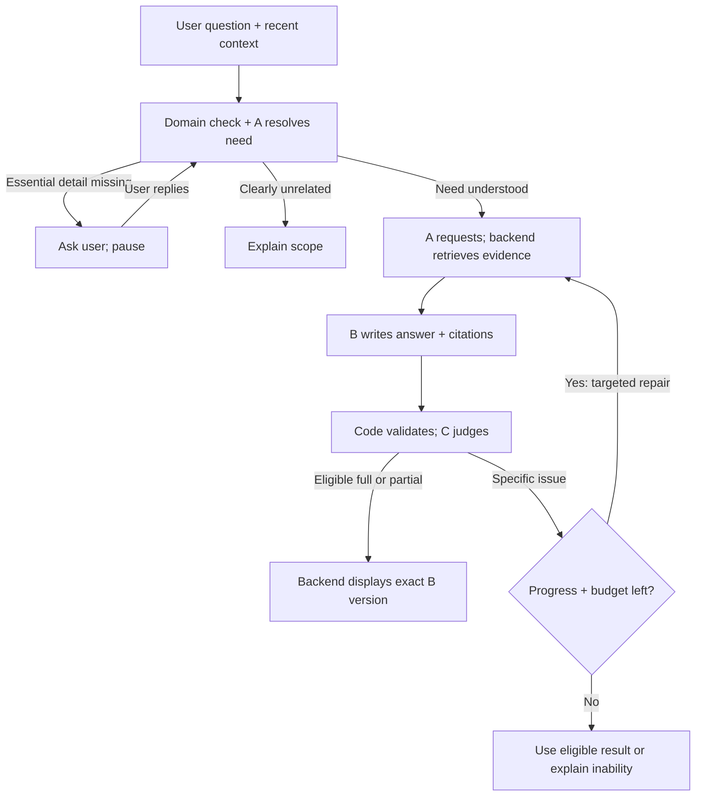

# Wireless Assistant

Software Requirements Specification

**Document ID:** WA-SRS-001
**Version:** 0.9
**Date:** 12 October 2026
**Status:** Review draft - proposed implementation baseline
**Repository:** Yuvraj-arch79/wireless-assistant

> This is a requirements document, not a claim that the product is implemented or tested.

## Document control and reading guide

*01 / Purpose of this specification*

This document defines what Wireless Assistant must do, how users should experience it, and how the team will check that it works. It covers the complete first-release journey from a question to an evidence-backed answer, including follow-up questions and failure cases.

<!-- widths: 0.28,0.72 -->
| Field | Value |
| --- | --- |
| Document ID | WA-SRS-001 |
| Version / date | 0.9 / 12 October 2026 |
| Status | Review draft. No implementation, test result or approval is implied. |
| Project / repository | Wireless Assistant / Yuvraj-arch79/wireless-assistant |
| Related brief | docs/product-brief.md; the user's edited problem statement is the product basis. |
| Decision owner | Project owner; individual reviewer names are not yet assigned. |
| Approval path | Review the requirements and open decisions, then approve the baseline through the repository's normal review process. |

### How to read requirement labels

Each requirement has a stable ID, a plain-English rule and an observable check. CONFIRMED means the behavior was agreed in the discussion. PROPOSED means an engineering safeguard or delivery detail is recommended here and still needs baseline approval. Neither label means the software already implements it.

The word must describes the required behavior after the relevant baseline is accepted. Open decisions are listed separately; they must not become silent assumptions in code. Requirements are mandatory for the first release unless explicitly marked as a future option.

### Reading paths

- For the project owner: read the problem, scope, workflow, release decisions, open decisions and release checklist.
- For developers: also read all requirement pages, data records and interfaces.
- For testers: use the acceptance scenarios and the complete requirement-to-test mapping.

> **Scope of the document**
> This is an enterprise-style project specification, written in simple English. It does not claim to be a Google internal template or a certification against an external standard.

## The user problem and intended outcomes

*02 / Product basis*

Users seeking wireless communication information face five related challenges:

- Difficulty understanding technical information: Technical terminology and dense specifications can make concepts and procedures difficult to understand.
- Difficulty finding relevant information: Users may not know which document, section or specification contains the information needed to answer their question.
- Answers that do not match user needs: Responses may provide a definition when the user needs an example, comparison, procedure or explanation at a different level of detail.
- Difficulty verifying answers: Responses without traceable supporting sources make it difficult for users to assess their reliability.
- Loss of context during follow-up questions: Users may need to repeat previous information when an assistant fails to maintain relevant conversation context.

Wireless Assistant aims to address all five challenges by helping users obtain accurate, relevant, understandable and verifiable answers while maintaining continuity across follow-up questions.

<!-- widths: 0.25,0.75 -->
| Goal | What success means for the user |
| --- | --- |
| G1 / Understand | An explanation uses the requested language and depth and explains necessary terminology. |
| G2 / Find | The assistant locates relevant passages in its declared 3GPP collection. |
| G3 / Match the need | The answer addresses the actual question, requested output and important constraints. |
| G4 / Verify | The user can inspect the specification, version and section supporting a claim. |
| G5 / Continue | Relevant follow-up context is retained without repeatedly asking for known information. |

> **What satisfying a need means**
> The user's original question, relevant history and clarification replies define the need together. A plausible answer or a judge's approval alone does not prove that the need has been met. Missing parts must remain visible.

## Users, scope and boundaries

*03 / First-release product scope*

### Intended users - proposed until validated

<!-- widths: 0.31,0.69 -->
| User | Main need |
| --- | --- |
| Learner or student | Understand a concept, acronym, comparison or procedure with a simple example. |
| Wireless engineer | Find an applicable 3GPP clause and understand its conditions and version. |
| Researcher or technical reader | Follow references across documents and compare supported explanations. |
| Project maintainer | Prepare the document collection, configure API access and inspect failures. |

These are examples of possible users, not fixed answer categories. Response depth follows the question and expressed needs, not an assumed label such as student or engineer.

### Included in the first release

- A text chat assistant for 3GPP cellular information available in a declared, pre-indexed collection.
- Definitions, explanations, examples, comparisons and procedure-oriented answers when the evidence supports them.
- Relevant conversation history, necessary clarification questions, source references and explicit limitations.
- A retrieves context; B writes; C judges; backend code controls the process and the user interface displays the result.
- A localhost deployment using configured free cloud APIs. Chat records and the prepared corpus are stored locally.

### Outside the first release

- General-purpose answers outside the agreed cellular domain, including a blanket promise to cover all wireless technologies.
- Live network control, equipment configuration, automatic standards compliance certification, or replacing professional engineering validation.
- Live web search or downloading new standards on every user question.
- Model training, fine-tuning, local generative models, automatic paid API fallback, public multi-user hosting, voice and image input.

> **Coverage is a published boundary**
> The product name is broad; the first-release knowledge scope is 3GPP cellular. Exact specifications, releases and versions remain an open decision. A missing document is a coverage gap, not proof that 3GPP has no answer.

## Decisions already agreed

*04 / Baseline constraints*

<!-- widths: 0.37,0.63 -->
| Decision | Required consequence |
| --- | --- |
| A collects the relevant context | A identifies the need, resolves references and requests evidence. Backend tools execute searches. |
| B writes the technical answer | The final technical response comes from a version of B's answer. |
| C only judges | C returns findings and a review status. It never rewrites the response. |
| Backend delivers the response | Code applies process rules and displays the eligible B answer; there is no fourth synthesis LLM. |
| RAG uses prepared 3GPP content | Documents are acquired, parsed and indexed before question answering. |
| History is selected, not dumped | Use recent relevant context and retrieve older original messages when needed. |
| Clarify only meaningful gaps | Ask when an unresolved detail would change the answer; do not repeat known questions. |
| Bounded checking | Initial draft plus at most two correction rounds; stop earlier when further work will not help. |
| Limitations are acceptable | Return a checked useful partial answer with specific gaps when a complete answer is unavailable. |
| No blind confidence target | A similarity score or self-reported confidence is not a probability that an answer is correct. |
| Free API constraint | Use configured free cloud services; quota failures cannot silently trigger paid calls. |

### Details this SRS proposes

Exact state names, data records, validation rules, local privacy controls, evaluation gates and release procedures are implementation proposals. The document labels these PROPOSED. The architecture constrains responsibilities without choosing a programming framework, vector database or model provider.

> **A role is not a model purchase**
> A, B and C are separate responsibilities and calls. They may use the same underlying model or different models. The final selection must be based on measured quality, quota, latency and the ability to keep each role within its task.

## From user input to user output

*05 / End-to-end behavior*

Backend code owns every transition. The user does not need to see role names, internal review messages or search parameters. While work is running, the interface shows a short progress message.

<!-- widths: 0.3,0.7 -->
| Stage | What happens |
| --- | --- |
| Receive and understand | Save the message; inspect recent context; use cheap domain clues; let A resolve ambiguity. |
| Ask or retrieve | Ask one focused clarification if essential information is missing. Otherwise search prepared sources and older history as needed. |
| Write and check | B writes with citations. Code checks references and format. C checks meaning, support and fit to the need. |
| Release or stop | Deliver the eligible answer. If repair is justified, revise within the shared budget. Otherwise produce a checked partial answer or a clear inability notice. |

> **Offline documents do not mean an offline assistant**
> The prepared 3GPP documents and index are local. Cloud embeddings and A/B/C calls still need internet access. The product must explain this distinction.

## Who does what

*06 / Ownership and boundaries*

<!-- widths: 0.17,0.38,0.45 -->
| Part | Receives | Produces / must not do |
| --- | --- | --- |
| A / Context | Original query, relevant recent messages, current need and available collection details. | Need record, retrieval requests, evidence package or a clarification. Must not replace original evidence with an unsupported summary. |
| B / Writer | Original query, critical replies, need record, selected history and original source passages. | Answer with claim-linked sources; explicit missing items or a targeted evidence request. Must not approve itself. |
| C / Judge | The same need and source context, plus the exact B draft and earlier findings when relevant. | Review status and specific findings. Must not supply a rewritten final answer. |
| Backend / Code | Role outputs, stored records, configuration and API responses. | Tool execution, record validation, shared limits, version binding and final delivery. It does not infer technical truth from a citation ID. |
| Interface | Backend status and an eligible response. | Readable answer, citations and limitations. It does not send hidden drafts or internal debate as a final answer. |

### When B and C disagree

C must identify the disputed statement, the relevant user requirement or source passage, and the reason for the finding. B may explain its interpretation and request precise additional evidence, but this does not override a failed review. A may retrieve that evidence. Code checks whether another bounded attempt is allowed.

C can also be wrong. An unsupported objection does not authorize a blind rewrite. The issue is recorded, evidence is sought only if useful, and unresolved material disagreement becomes a limitation. No further judge is added to judge C indefinitely.

> **Protecting a good answer**
> Keep every B draft. Change only justified parts and check for lost correct content. These controls reduce harmful revisions; they cannot guarantee that one LLM will never make another LLM's answer worse.

## Main user journeys

*07 / Use cases*

<!-- widths: 0.25,0.43,0.32 -->
| Journey | Expected experience | Main exception |
| --- | --- | --- |
| UC1 / Explain a concept | Ask a cellular question; receive a suitable explanation with sources and a labeled example if requested. | The needed section is absent or the term is ambiguous. |
| UC2 / Compare two items | The assistant resolves both items from the query or history and compares the requested aspects. | It asks which items only when history cannot resolve them. |
| UC3 / Follow up | Ask 'explain the third point' or 'give an example'; the assistant uses the correct prior answer. | If multiple points are plausible, it asks a focused question. |
| UC4 / Specify a release | Ask for a procedure in a chosen release; the answer uses sources compatible with that scope. | The collection lacks the selected release or only supports part of the question. |
| UC5 / Inspect evidence | Open a source reference and see the document version, section and relevant passage. | An external link fails; locally available evidence is still identified. |
| UC6 / Incomplete evidence | Receive the useful supported part and a precise statement of what could not be established. | No useful part can be checked; the assistant explains the limitation. |
| UC7 / Service interruption | See a clear quota, timeout or connection message and retain the conversation. | The user retries later; the earlier request must not publish duplicate answers. |
| UC8 / Unrelated question | Receive a short scope explanation and an invitation to ask a cellular question. | A keyword-free follow-up must not be rejected as unrelated. |

### Common preconditions

The local application is running; valid permitted API configuration is present; the corpus inventory and index are available. If any condition is missing, the application shows the specific setup problem instead of pretending to answer.

### Common result

Every active request ends in an answer, a partial answer with limitations, a clarification, an out-of-scope response, a service failure or a cancellation. Clarification pauses the need, with no background calls while waiting. The user's reply starts a linked request using the updated need. Internal retries must never masquerade as a new user request to reset a budget.

## Input, domain and clarification

*08 / Functional requirements - DOM*

### DOM-01 - Keep the original request

**Status:** CONFIRMED

The system must retain the user's exact question and pass it, with critical clarification replies, to B and C. A's summary must not be the only representation.

**Check:** Inspect B and C inputs for a question containing a special constraint.

### DOM-02 - Use domain clues carefully

**Status:** CONFIRMED

Backend vocabulary rules may provide an initial domain signal. A must resolve uncertain cases using context; absence of cellular words must not by itself reject a request.

**Check:** A valid 'iska example' follow-up reaches the context step.

### DOM-03 - Explain clear scope limits

**Status:** CONFIRMED

For a clearly unrelated request, the system must explain its cellular scope briefly and avoid running a full technical answer cycle.

**Check:** An unrelated question receives a scope message without B/C answer work.

### DOM-04 - Ask when the answer depends on it

**Status:** CONFIRMED

A must ask a focused question if an unresolved topic, comparison item, release or other essential detail would materially change the answer.

**Check:** An ambiguous comparison pauses for the missing item.

### DOM-05 - Use information already available

**Status:** CONFIRMED

The system must check the query and relevant history before asking. It must not ask again for a detail already clearly supplied.

**Check:** An explicit release in the preceding message is reused.

### DOM-06 - Pause and resume clarification

**Status:** PROPOSED

A pending clarification must pause retrieval and answer generation that depend on it. The reply must resume the same need; a changed topic must create an updated need.

**Check:** The reply is linked to the pending question, without a duplicate answer cycle.

### DOM-07 - Avoid unnecessary questioning

**Status:** CONFIRMED

If a useful answer can be given without a missing optional detail, the system must proceed and state any material assumption rather than force a clarification.

**Check:** A basic definition is answered without demanding an irrelevant release.

### DOM-08 - Separate scope from coverage

**Status:** CONFIRMED

An in-domain question with no retrieved evidence must be handled as a coverage or retrieval limitation, not as an unrelated question.

**Check:** An absent cellular topic produces a coverage limitation.

## Conversation history and the need record

*09 / Functional requirements - CTX*

### CTX-01 - Store original conversation

**Status:** CONFIRMED

The system must save original user messages and displayed assistant responses locally with order, role, session and message identifiers.

**Check:** Reopen a session and recover its exact visible conversation.

### CTX-02 - Select recent context

**Status:** CONFIRMED

Each request must receive relevant recent messages within a configured context budget; the entire conversation must not be sent by default.

**Check:** A long-session trace shows bounded selected context.

### CTX-03 - Retrieve older details on demand

**Status:** CONFIRMED

A must request older original messages when the question depends on them. Retrieved results must retain their message IDs and conversation boundaries.

**Check:** An old preference or comparison is recovered from the same session.

### CTX-04 - Use summaries as aids

**Status:** CONFIRMED

A compact summary may support long conversations. It must retain links to original messages and must not replace them for exact wording, lists or disputed details.

**Check:** A 'third point' reference resolves to the original answer.

### CTX-05 - Avoid automatic extra LLM calls

**Status:** CONFIRMED

History selection must use direct recent context and stored state when sufficient. A separate summarization or routing call must not be required on every message.

**Check:** A simple follow-up completes without an unnecessary summary call.

### CTX-06 - Record the current need

**Status:** CONFIRMED

The internal need record must capture the topic, requested task, language, depth, constraints, unresolved details and links to the messages that establish them.

**Check:** The record distinguishes 'compare with an example' from 'define'.

### CTX-07 - Respect user corrections

**Status:** CONFIRMED

The latest explicit correction must override an older conflicting preference. If the meaning of the correction is unclear, the system must clarify it.

**Check:** A request to use Release X supersedes an earlier Release Y.

### CTX-08 - Keep format flexible

**Status:** CONFIRMED

A stable internal record format may be used, but the user-facing answer must follow the actual request rather than a compulsory fixed answer template.

**Check:** A short explanation and a requested comparison table use different formats.

## Preparing the 3GPP collection

*10 / Functional requirements - RAG*

### RAG-01 - Declare coverage

**Status:** CONFIRMED

The collection must list each included specification, title, release where known, version, source location and ingestion status. The product must not claim unindexed coverage.

**Check:** The inventory matches the files available to retrieval.

### RAG-02 - Prepare documents before questions

**Status:** CONFIRMED

Document acquisition, parsing and indexing must run separately from normal chat requests. A question must search the prepared collection.

**Check:** A query does not start downloading the standards archive.

### RAG-03 - Preserve source structure

**Status:** CONFIRMED

Parsing must preserve numbered sections, headings, relevant tables, notes and cross-references. Unsupported or unreadable content must be flagged.

**Check:** Sample clauses and table notes can be traced back to the source.

### RAG-04 - Split by meaning

**Status:** CONFIRMED

Chunks must follow meaningful section boundaries where possible. Large sections may be split, with parent and neighboring context retained for reconstruction.

**Check:** A split procedure can recover its heading and preceding conditions.

### RAG-05 - Store text with each vector

**Status:** CONFIRMED

Each searchable chunk must keep its original text, stable ID, source metadata and content version alongside its embedding reference.

**Check:** Every returned chunk can resolve to original readable evidence.

### RAG-06 - Keep embeddings compatible

**Status:** PROPOSED

Index and query embeddings must use compatible models and dimensions. A model change must trigger a controlled index migration or rebuild, not mix incompatible vectors.

**Check:** An incompatible index is rejected before search.

### RAG-07 - Avoid repeated ingestion cost

**Status:** CONFIRMED

Unchanged documents and chunks must be reusable. New embeddings must be created only when relevant source content or embedding configuration changes.

**Check:** Re-running ingestion on unchanged files does not re-embed them.

### RAG-08 - Publish a valid collection atomically

**Status:** PROPOSED

The maintainer must validate a prepared collection before activation, retain its version and support rollback. Partially built collections must not become active.

**Check:** Interrupted ingestion leaves the previous valid index usable.

## Retrieving evidence at question time

*11 / Functional requirements - RET*

### RET-01 - Separate request from execution

**Status:** CONFIRMED

A must describe the required evidence and search scope. Backend tools must execute searches over the indexed corpus and return source-linked passages.

**Check:** Search traces identify the request, filters and returned chunk IDs.

### RET-02 - Respect version scope

**Status:** CONFIRMED

Retrieval must apply explicit specification, release or version constraints. If a default is used, it must be recorded and disclosed when it affects the answer.

**Check:** A requested release never silently receives another release's rule.

### RET-03 - Pass original evidence

**Status:** CONFIRMED

B and C must receive the actual retrieved text and metadata. Vector values or A's paraphrases must not serve as the supporting source.

**Check:** A citation's original passage is present in the review context.

### RET-04 - Support exact and semantic matches

**Status:** PROPOSED

Retrieval must support both meaning-based search and exact identifiers or terms. A combined search or equivalent tested method may be chosen.

**Check:** A clause number and a paraphrased question both retrieve relevant material.

### RET-05 - Expand necessary context

**Status:** CONFIRMED

A must be able to request definitions, parent sections, neighboring chunks or referenced clauses when a passage alone is incomplete.

**Check:** A condition or table note missing from the first result is included before answering.

### RET-06 - Tune retrieval with evidence

**Status:** PROPOSED

The number of passages, score cutoffs and optional reranking must be selected using representative evaluated questions. Similarity scores must not be shown as truth probabilities.

**Check:** Configuration records link settings to a retrieval evaluation.

### RET-07 - Handle missing and conflicting evidence

**Status:** CONFIRMED

A must report missing evidence and version conflicts explicitly. No result in the collection must not be described as no such rule anywhere in 3GPP.

**Check:** An absent passage produces a scoped limitation, not an invented answer.

### RET-08 - Bound repeat searches

**Status:** CONFIRMED

Additional searches must target a specific missing item and use the shared request budget. Equivalent searches with no new evidence must trigger an early stop.

**Check:** Repeated empty results do not create an endless retrieval loop.

## B writes the answer

*12 / Functional requirements - ANS*

### ANS-01 - Answer the actual need

**Status:** CONFIRMED

B must address the original request and relevant clarified requirements, including examples, comparisons, requested depth and constraints.

**Check:** A comparison request is not passed as satisfied by two isolated definitions.

### ANS-02 - Ground technical claims

**Status:** CONFIRMED

B must link material factual claims to supporting evidence. It must distinguish source-backed statements, reasonable explanations and illustrative examples.

**Check:** An illustrative example is not presented as verbatim normative 3GPP text.

### ANS-03 - Preserve conditions and exceptions

**Status:** PROPOSED

B must retain source conditions that change the answer, including applicable release, optional behavior, exceptions and the difference between required and permitted actions.

**Check:** A conditional or optional rule is not rewritten as universally mandatory.

### ANS-04 - Request precise missing data

**Status:** CONFIRMED

When information is insufficient, B must identify what is missing and why it matters. The backend routes eligible evidence requests to A or a necessary clarification to the user.

**Check:** A request names the missing condition rather than asking to search everything again.

### ANS-05 - Write limitations with the answer

**Status:** CONFIRMED

B must state which parts are answered, which remain unresolved and why. It must not cover known false or unsupported claims with a generic disclaimer.

**Check:** A partial answer removes the unsupported assertion and names the missing evidence.

### ANS-06 - Revise only justified parts

**Status:** CONFIRMED

B must tie each substantive revision to evidence or a specific user requirement. The system must retain the previous draft and the reason for change.

**Check:** A correction record identifies the changed claim and justification.

### ANS-07 - Use simple, suitable language

**Status:** CONFIRMED

B must follow the user's requested language and level, explain necessary abbreviations and keep structure appropriate to the requested task.

**Check:** A beginner explanation defines its necessary jargon; a requested short answer stays concise.

### ANS-08 - Be the only technical writer

**Status:** CONFIRMED

The technical answer shown to the user must come from B. C and any display component must not silently rewrite, expand or summarize its meaning after review.

**Check:** The delivered answer content matches the eligible stored B version.

## C judges the answer

*13 / Functional requirements - REV*

### REV-01 - Review the exact draft

**Status:** CONFIRMED

C must receive the original need, critical messages, relevant history, actual source evidence and the exact B answer version being assessed.

**Check:** A review cannot be reused for a changed draft or different evidence set.

### REV-02 - Return findings, not a new answer

**Status:** CONFIRMED

C must return a review decision and specific findings only. It must not return a replacement user-facing technical answer.

**Check:** The review schema rejects a rewritten-final-answer field.

### REV-03 - Separate issue types

**Status:** CONFIRMED

Findings must distinguish contradicted claims, insufficient support, missing user requirements and presentation problems. Missing evidence alone must not be called proof of falsehood.

**Check:** An unsupported claim and a contradicted claim have different finding types.

### REV-04 - Make objections actionable

**Status:** CONFIRMED

Each blocking finding must identify the affected claim or requirement and explain the reason, including source evidence when available. A vague style preference must not force a factual rewrite.

**Check:** A finding such as 'make it better' cannot authorize an automatic correction.

### REV-05 - Check support and coverage

**Status:** PROPOSED

C must assess factual support, relevant conditions, citation fit, user-need coverage and material consistency. A valid citation identifier alone must not count as support.

**Check:** A real but unrelated citation causes a support finding.

### REV-06 - Check for regression

**Status:** CONFIRMED

When B revises an answer, C must check the affected issue and whether the revision removed correct required content or introduced a new material error.

**Check:** A repair that loses the requested example is caught.

### REV-07 - Allow an honest partial result

**Status:** CONFIRMED

C may accept a partial answer when its asserted content is supported and its unresolved requirements are stated accurately. It must not label that result as a fully satisfied need.

**Check:** A partial decision retains explicit unmet requirement IDs.

### REV-08 - Treat judge quality as measurable

**Status:** PROPOSED

The project must measure C's missed errors, false objections and harmful revisions against human-reviewed examples. C's self-reported confidence must not be the sole release gate.

**Check:** Evaluation includes both flawed drafts and already correct drafts.

## Backend control and finite checking

*14 / Functional requirements - ORC*

### ORC-01 - Own the workflow in code

**Status:** CONFIRMED

Backend code must control states, call permissions, tool execution and final delivery. A role must not independently start an unbounded chain of calls.

**Check:** A malformed or excessive role request cannot bypass the controller.

### ORC-02 - Enforce two correction rounds

**Status:** CONFIRMED

A request may have one initial B draft and C review, then at most two B correction drafts with reviews. Changing roles or issue labels must not reset this counter.

**Check:** Repeated objections end after no more than three B draft versions.

### ORC-03 - Use shared resource limits

**Status:** CONFIRMED

The request must have configured total call, retrieval, time and token limits. Provider retries and review-format repairs count toward them.

**Check:** Nested calls stop at the same overall budget boundary.

### ORC-04 - Reserve a closing path

**Status:** PROPOSED

The controller must reserve enough budget to attempt a final B response and its C review within the same allowed drafts. It must stop optional retrieval before consuming that reserve.

**Check:** A near-limit request enters partial-answer mode instead of starting more broad searches.

### ORC-05 - Stop when progress stops

**Status:** CONFIRMED

Repeated issues or unavailable evidence must stop repair searches. If an allowed draft and closing budget remain, use them for a final limited answer; otherwise end. A higher confidence score alone is not progress.

**Check:** The same issue does not keep cycling; a closing draft still counts toward the two-correction limit.

### ORC-06 - Bind approval to the answer

**Status:** PROPOSED

Delivery must require successful basic checks and a valid C decision for the same answer, need and evidence versions. Invalidated earlier drafts must not be used as fallback.

**Check:** A stale pass cannot release a later modified answer.

### ORC-07 - Never release a failed draft by default

**Status:** PROPOSED

At termination, the system must use a still-valid reviewed answer or partial answer. Otherwise it must show an operational inability notice, without unverified technical claims.

**Check:** Budget exhaustion does not turn a failed draft into a final answer.

### ORC-08 - Make completion consistent

**Status:** PROPOSED

Each request must have one terminal result. Cancellation, timeout and retry races must not publish late or duplicate answers into the conversation.

**Check:** A late API response after cancellation is ignored for display.

## How the final result is selected

*15 / Release rules without an infinite judge loop*

These rules implement ORC-01 to ORC-08. Code checks identifiers, allowed states, source existence, budgets and version matches. C checks meaning. Code cannot determine technical truth merely by validating a JSON record.

<!-- widths: 0.3,0.4,0.3 -->
| Observed situation | Next action | Visible result |
| --- | --- | --- |
| Meaning-changing detail is missing | A asks a focused clarification; dependent processing pauses. | Clarification question. |
| Draft passes basic checks and C accepts all requested parts | Release the exact eligible B version. | Complete answer with sources. |
| B explicitly limits the answer; C accepts its support and gap statements | Release the exact eligible B version with partial status. | Supported partial answer and specific limitations. |
| C reports a specific resolvable issue and budget remains | Retrieve targeted evidence if needed; B revises; C reviews. | Progress status until a terminal result. |
| C raises an ungrounded or invalid objection | Do not blindly rewrite B. Validate the finding; seek clarification or evidence only within budget. | No automatic release while a material valid review is missing. |
| Final allowed correction is starting | B fixes supported issues and qualifies or omits unresolved claims; C reviews this final candidate. | Complete or partial answer if eligible. |
| Budget ends or no further progress is possible | Use a still-valid previously reviewed candidate, if one exists and addresses the current need; otherwise stop. | Eligible answer, or a clear inability notice. |
| API failure prevents the reserved final review | Do not pretend the review passed or publish the unchecked draft. | Service limitation with retry guidance. |

> **The limit includes the final correction**
> There is no extra B rewrite after the two correction rounds and no unchecked answer cleanup by C. If the final candidate still fails, a fixed operational message may state the recorded blocker. It must not invent a technical answer. This is a proposed implementation of the agreed bounded-checking policy.

Example inability notice: 'I could not verify this answer against the available sources. The missing item is the applicable procedure for your requested release. Please specify a supported release or try again after the collection is updated.' The missing item must come from the recorded request state.

## Answers, citations and interface behavior

*16 / Functional requirements - UX*

### UX-01 - Keep the chat readable

**Status:** PROPOSED

The interface must support sending text, seeing conversation history, starting a new session and reopening a saved session. It must clearly show pending and completed states.

**Check:** A user can continue a saved conversation without setup knowledge.

### UX-02 - Match citations to claims

**Status:** CONFIRMED

Source markers must be placed near the material claims they support, with a reference list at the end of the answer.

**Check:** Each cited claim resolves to the referenced supporting passage.

### UX-03 - Show meaningful source details

**Status:** CONFIRMED

A reference must identify the specification, document version, section and source location; release information must be shown when known and relevant.

**Check:** The user can distinguish the same clause from two versions.

### UX-04 - Allow evidence inspection

**Status:** PROPOSED

Opening a citation must show the relevant original passage and its source identity. The user must be able to inspect available local evidence even if an external link is unavailable.

**Check:** A broken website link does not remove the stored source context.

### UX-05 - Show limitations where they matter

**Status:** CONFIRMED

A partial answer must state the unanswered part and reason near the answer, not hide it behind a generic footer or an unexplained confidence number.

**Check:** A user can identify the missing part without opening developer logs.

### UX-06 - Hide internal drafts

**Status:** CONFIRMED

The interface must not display C's internal review, hidden drafts or unreviewed answer tokens as a completed technical answer. Progress messages may be shown.

**Check:** A rejected draft never appears as the final user response.

### UX-07 - Support simple interaction

**Status:** PROPOSED

Core chat and citation actions must work with keyboard navigation, visible focus and readable text. Status must not rely only on color.

**Check:** A keyboard-only user can send a message and open its reference.

### UX-08 - Handle retry and cancellation

**Status:** PROPOSED

The interface must allow cancellation and an explicit retry after a service error. It must preserve the question and avoid presenting a retry as a new user intention.

**Check:** Retrying a timeout does not duplicate the saved user message.

## Records the system needs to keep

*17 / Data requirements and provenance*

These are logical records, not a mandated database design. Identifiers connect a result to the messages, source passages and decisions that produced it. Exact storage technology remains open.

<!-- widths: 0.24,0.46,0.3 -->
| Record | Minimum information | Why it exists |
| --- | --- | --- |
| Conversation message | Session ID, message ID, role, exact text, order and timestamp. | Recover original context and references such as 'third point'. |
| Need record | Need version, original query ID, topic, task, constraints, language/depth, clarifications and unresolved items. | Keep the user's actual goal visible to every role. |
| Corpus manifest | Collection version, included document IDs, spec/version/release, acquisition source, parse status and content hash. | Declare coverage and reproduce retrieval. |
| Evidence passage | Chunk ID, original text, document/section IDs, parent/neighbor links, version and source location. | Trace a claim to the correct original context. |
| Retrieval record | Request ID, question or target gap, filters, embedding/index version and returned passage IDs. | Explain a missing or irrelevant result. |
| B answer version | Draft ID, need/evidence versions, text, claim-to-source links, gaps and revision reason. | Preserve good content and bind review to a draft. |
| C review | Draft ID, review status, finding type, affected claim/requirement, evidence links and remaining gaps. | Support a specific, reviewable release decision. |
| Request run | Request ID, state, role/model versions, budget used, attempts, stop reason and displayed answer ID. | Prevent loops and diagnose failures. |

### Integrity rules

- A displayed technical answer must resolve to its stored B version and review. References must resolve to the evidence version used, even after an index update.
- Summaries and history indexes are derived data. Original messages remain the source for exact conversation facts.
- History is user context, not proof of a 3GPP technical rule. A previous assistant error must not become evidence just because it was saved.
- Deleted records must not remain retrievable through an undeleted summary, vector index or cache. Retention behavior is defined in SEC-04 and SEC-05.

## Interfaces and deployment

*18 / Functional requirements - API*

### API-01 - Run locally with clear prerequisites

**Status:** CONFIRMED

The first release must run on localhost with documented setup, local data paths and required internet/API access. Public hosting is not part of this baseline.

**Check:** A clean supported machine can follow the setup guide.

### API-02 - Keep API access on the backend

**Status:** PROPOSED

The browser must call the application backend. Cloud provider keys and provider requests must remain on the backend.

**Check:** Browser source and responses contain no provider secret.

### API-03 - Validate role contracts

**Status:** PROPOSED

A, B and C outputs must use validated internal structures for needs, evidence requests, drafts and findings. Invalid structures must trigger bounded recovery or a clear failure.

**Check:** A malformed C result cannot be interpreted as a pass.

### API-04 - Use configurable role providers

**Status:** CONFIRMED

The model/provider for each role and embedding service must be configurable. The same model may fill several roles, but its prompts and output permissions must remain separate.

**Check:** Changing B's provider does not grant C permission to rewrite answers.

### API-05 - Stay within free-service constraints

**Status:** CONFIRMED

The initial configuration must use services available within the user's free allowance. It must not enable billing, paid fallback or a new paid provider automatically.

**Check:** Free quota exhaustion yields a clear limitation and no paid call.

### API-06 - Handle cloud failures explicitly

**Status:** PROPOSED

Timeouts, rate limits, invalid keys and unavailable providers must have bounded retries within the shared budget and distinct failure reasons.

**Check:** Repeated rate limits stop without losing the conversation.

### API-07 - Document supported boundaries

**Status:** PROPOSED

The release must declare supported operating systems, browser versions, input limits, languages, collection size and tested hardware. Unsupported inputs must fail clearly.

**Check:** Oversized input is explained; no silent loss of essential text occurs.

> **Logical interfaces**
> User interface to backend: submit, cancel, retry, history and citations. Backend to cloud APIs: A/B/C and embeddings. Backend to local stores: corpus, search, messages and run records. Setup operations: configure providers, validate and activate a collection. Exact endpoints are a design decision.

## Failure and exception behavior

*19 / Expected behavior when something goes wrong*

<!-- widths: 0.25,0.43,0.32 -->
| Condition | Required response | Do not do this |
| --- | --- | --- |
| Empty or unusable input | Ask for a question; explain a supported input limit if needed. | Run the full pipeline on an empty request. |
| Essential meaning is ambiguous | Ask a short focused clarification and pause dependent work. | Guess the two items or repeatedly ask known details. |
| No evidence in the active collection | Name the searched scope and the missing answer part; return supported material if available. | Assert that no 3GPP specification contains the information. |
| Sources use different versions | Separate the version-specific statements or ask which scope is needed. | Merge conflicting rules into one universal answer. |
| Unreadable table or missing note | Flag the extraction gap and avoid relying on the damaged passage. | Fill in the unreadable value from model memory. |
| B and C disagree | Identify the disputed claim; seek targeted evidence only if useful and within budget. | Let B self-approve or add endless judges. |
| Repeated retrieval or review failure | Stop early; attempt a checked partial answer within the remaining allowed draft budget. | Reset counters or wait for a confidence score to increase. |
| No eligible draft at the stop point | Show the recorded inability reason with a useful next step. | Publish the last failed draft with a disclaimer. |
| Internet, quota or provider failure | Keep the question, show a service message and allow an explicit retry. | Pretend that the missing review was completed. |
| Cancellation or restart | Record the final request state; ignore late results; recover saved conversation safely. | Display a delayed answer for a canceled request. |
| Instruction hidden inside a source | Treat it as document content; keep application instructions in control. | Execute commands or reveal keys because a passage asks for them. |

Errors should be understandable without exposing stack traces, hidden prompts, API keys or internal review debates. Detailed diagnostics belong in protected development records.

## Privacy and security

*20 / Non-functional requirements - SEC*

### SEC-01 - Protect secrets

**Status:** PROPOSED

API keys must be kept out of source control, browser code, ordinary logs, exported documents and chat messages. Setup must use placeholders in examples.

**Check:** Repository and interface checks find no real credentials.

### SEC-02 - Explain cloud data use

**Status:** PROPOSED

Before cloud processing, setup must explain that selected questions, history and source passages may leave the local device. It must identify configured providers and their applicable data settings.

**Check:** A user can see which services receive data before the first call.

### SEC-03 - Send only necessary context

**Status:** PROPOSED

Each call must contain only the history and evidence needed for its task, within budget. Unrelated conversations must never be included.

**Check:** A session-isolation test finds no messages from another session.

### SEC-04 - Provide local history deletion

**Status:** PROPOSED

The user must be able to delete a local conversation and its derived summaries, search entries and caches. The operation must explain its scope.

**Check:** Deleted content is absent from subsequent history retrieval.

### SEC-05 - Declare retention and backup behavior

**Status:** PROPOSED

The release must document local retention, diagnostic logging and backup deletion. It must not imply that local deletion also deletes provider-held copies.

**Check:** Retention settings and limitations are visible and testable.

### SEC-06 - Treat retrieved content as untrusted

**Status:** PROPOSED

Instructions embedded in documents or quoted history must not override system roles, request secrets, invoke tools or change release rules.

**Check:** An injected instruction in a retrieved passage cannot bypass C or expose a key.

### SEC-07 - Restrict local access

**Status:** PROPOSED

The service must bind to loopback by default, validate allowed browser origins and protect local files from path traversal. Public exposure requires a separate security design.

**Check:** A remote-origin request and a path outside approved data locations are rejected.

### SEC-08 - Control document handling

**Status:** PROPOSED

Ingestion must validate supported file types, sizes and parsing failures. Third-party source documents must not be published to GitHub automatically.

**Check:** A malformed file is isolated and does not corrupt the active collection.

## Reliability, speed and resource use

*21 / Non-functional requirements - OPS*

### OPS-01 - Keep work bounded

**Status:** CONFIRMED

All requests must stop under configured time, token, call and correction limits, including tool and provider retries.

**Check:** Fault-injection tests terminate every run with a recorded reason.

### OPS-02 - Acknowledge and show progress

**Status:** PROPOSED

The interface must acknowledge submission promptly and show meaningful running states without exposing an unreviewed answer.

**Check:** Local acknowledgement is measured against the proposed target on the quality page.

### OPS-03 - Measure response time honestly

**Status:** PROPOSED

The system must record end-to-end time and time per stage, distinguishing full, partial, clarification and failed requests.

**Check:** A report shows median and slow-tail latency with the tested setup.

### OPS-04 - Recover consistent state

**Status:** PROPOSED

Saved messages and terminal results must survive a normal application restart. Interrupted runs must be marked interrupted rather than completed.

**Check:** Restart during generation preserves the question and does not invent a final answer.

### OPS-05 - Account for quotas and usage

**Status:** PROPOSED

The system must track observed calls and token usage where providers expose them, warn about known exhausted allowance and stop within configured local limits.

**Check:** A quota exhaustion case produces no additional forbidden calls.

### OPS-06 - Cache only compatible results

**Status:** PROPOSED

Caches must account for relevant need, source, model and prompt versions. An old answer must not be reused after a conflicting user correction or evidence update.

**Check:** A source update invalidates the dependent cached answer.

### OPS-07 - Avoid request races

**Status:** PROPOSED

The first release must queue or block overlapping dependent turns in the same conversation. Separate sessions must have isolated state.

**Check:** Two rapid submissions cannot attach a review to the wrong answer.

### OPS-08 - Publish measured limits

**Status:** PROPOSED

The release must state its tested capacity and dependency limits. It must not promise an availability level or response speed that the free providers cannot support.

**Check:** Release notes include hardware, corpus size, provider configuration and observed performance.

## Maintenance and visibility

*22 / Non-functional requirements - MNT*

### MNT-01 - Version the behavior

**Status:** PROPOSED

Prompts, model settings, retrieval configuration, code and corpus releases must have identifiable versions so a result can be investigated and a change can be evaluated.

**Check:** A sampled run resolves to its complete configuration versions.

### MNT-02 - Keep useful diagnostic records

**Status:** PROPOSED

The system must record states, source IDs, review findings, budget use and stop reasons with a request ID. Raw sensitive text must be excluded from ordinary logs by default.

**Check:** A failed citation or looping issue can be investigated without exposing secrets.

### MNT-03 - Collect simple quality feedback

**Status:** PROPOSED

A user must be able to flag an answer as wrong, unclear, irrelevant or incomplete and optionally explain the issue. Feedback must link to the answer version.

**Check:** A report can identify the exact answer and sources the user saw.

### MNT-04 - Separate testing from tuning

**Status:** PROPOSED

Evaluation examples used to measure release quality must be kept separate from examples used to tune prompts and retrieval. Changes must be checked against preserved regressions.

**Check:** The test set records its purpose and the release report identifies the held-out set.

### MNT-05 - Review and roll back changes

**Status:** PROPOSED

Changes to prompts, role models, corpus parsing or retrieval must include targeted evaluation and a path to the previous working version.

**Check:** A known-bad update can be disabled without losing chat history.

### MNT-06 - Provide reproducible setup

**Status:** PROPOSED

The repository must document installation, configuration, corpus preparation, startup, tests and known limitations using safe sample configuration.

**Check:** A maintainer can reproduce the documented local setup.

### MNT-07 - Keep specifications in sync

**Status:** PROPOSED

Changes to agreed behavior must update affected requirement IDs, tests and open decisions. PDF and editable SRS source must carry the same document version.

**Check:** A documentation change identifies the affected tests and regenerates the matching PDF.

> **Diagnostic scope**
> Store operational findings and concise reasons, not hidden model chain-of-thought. A trace should explain what happened, which evidence was used and why the controller stopped.

### Maintenance responsibilities

The project owner accepts product decisions. A developer maintains implementation and configuration. A domain reviewer checks reference answers and disputed technical judgments. A tester checks process behavior and regressions. One person may fill multiple roles initially; reviewer names and availability remain open.

## How quality will be measured

*23 / Evaluation plan and proposed pilot gates*

Passing an LLM review is a process event, not a scientific proof. Evaluate the full system and also isolate retrieval, B and C so the team can identify where a problem originates. Engineering references E1-E3 support this separation; the numerical targets below are project proposals, not industry guarantees.

<!-- widths: 0.27,0.73 -->
| Measure | Definition / proposed pilot gate |
| --- | --- |
| Requirement behavior | All applicable acceptance scenarios pass; zero known critical process, privacy or evidence-version defects. |
| Evidence retrieval | Required supporting passage appears in the bounded evidence set for at least 90% of answerable test questions. |
| Claim support | At least 95% of assessed material factual claims are supported by the cited evidence; report contradiction separately. |
| Need coverage | At least 90% of answerable test requests have all required parts addressed at the requested level. |
| Honest limitations | At least 95% of missing-evidence cases clearly disclose the gap; zero known fabricated source identifiers. |
| C false acceptance | No more than 5% of deliberately flawed drafts are wrongly approved in the reviewed test sample. |
| C false objection | No more than 10% of correct drafts receive an unjustified blocking objection in the reviewed sample. |
| Harmful revision | Zero observed material degradations in the designated correct-draft regression set; report sample size and uncertainty. |
| Usability and latency | At least 4 of 5 pilot users complete core chat/source tasks unaided. Proposed local acknowledgement: within 1 second; answer latency target set after a provider benchmark. |

### Build a representative test set

Proposed starting set: at least 100 independently reviewed questions, covering definitions, procedures, examples, comparisons, release-specific questions, follow-ups, ambiguous requests, unavailable evidence and unrelated questions. Use separate correct and flawed drafts for C evaluation. Reuse a question across categories only if this is counted transparently.

A domain reviewer records expected evidence and a clear scoring rubric. Evaluate B before review and the final delivered answer on the same tasks. Record omissions as well as wrong statements, because a system can appear accurate by refusing too many questions. Report denominators, unsupported-query refusal rates and variation across repeated runs.

> **Decision required before pilot**
> The project owner and domain reviewer must accept or revise these targets and the test set. A small pilot cannot establish zero real-world errors. If a target fails, the team must narrow scope, improve the system or document a reviewed release exception.

## Acceptance scenarios: understanding and evidence

*24 / Tests T01-T10*

<!-- widths: 0.1,0.36,0.54 -->
| Test | Scenario | Pass condition |
| --- | --- | --- |
| T01 | Simple in-scope question with a special output request. | Original wording and constraints reach B/C; the answer follows the task and language/depth request. |
| T02 | Keyword-free follow-up: 'iska example' after a cellular answer. | The correct prior topic is resolved; no false out-of-scope rejection or unnecessary question occurs. |
| T03 | Clearly unrelated question, then an in-scope topic missing from the corpus. | The first receives a scope message; the second receives a distinct coverage limitation. |
| T04 | Ambiguous comparison; user clarifies one item and then corrects the release. | Processing pauses, the reply updates the same need, the latest correction wins and known details are not asked again. |
| T05 | Long conversation with an older preference and a 'third point' reference. | Bounded recent context and selected original messages recover the right detail; a stale summary cannot override it. |
| T06 | Document ingestion with a large section, table note and cross-reference. | Chunks preserve structure and provenance; required parent/neighbor information is recoverable; unreadable content is flagged. |
| T07 | Repeated ingestion, changed embedding model and interrupted index activation. | Unchanged content is reused; incompatible vectors are rejected or migrated; the active valid index survives interruption. |
| T08 | Queries using exact clause identifiers and meaning-based paraphrases. | The expected passages are retrieved under tested settings; actual source text reaches B/C. |
| T09 | Question constrained to a release, with conflicting sources from another version. | Retrieval and answer honor scope; no silent version mixing occurs; material defaults are disclosed. |
| T10 | First search misses a needed definition or condition; repeated searches later add nothing. | A requests targeted expansion, then stops when the evidence gap cannot be resolved within budget. |

Test fixtures must be pinned to known document versions. The text in this SRS describes product behavior; it is not a substitute for expert-verified 3GPP reference answers.

## Acceptance scenarios: writing, judging and stopping

*25 / Tests T11-T20*

<!-- widths: 0.1,0.36,0.54 -->
| Test | Scenario | Pass condition |
| --- | --- | --- |
| T11 | B must give a comparison and a labeled example using a conditional rule. | All requested parts are present; conditions and optional/required meaning remain correct; claims link to supporting text. |
| T12 | Part of the answer lacks evidence but another part is supported. | B identifies the exact gap, writes an honest partial answer and removes unsupported assertions. C may accept partial status. |
| T13 | C sees a contradicted claim, an unsupported claim, an unrelated real citation and a missed requirement. | Findings identify the correct type, affected item and reason. C does not produce a rewritten answer. |
| T14 | A correct B draft receives a vague or wrong C objection. | No blind rewrite occurs. Any correction requires a specific reason and evidence; unresolved review does not become automatic approval. |
| T15 | A correction fixes one error but drops a correct requested example. | The regression is detected and the original draft remains available; C assesses the changed candidate. |
| T16 | C continues raising the same problem through the maximum rounds. | At most two correction drafts occur; no role resets the counter. Final output is eligible partial/full content or an inability notice. |
| T17 | Retrieval and provider retries approach time, token and call limits. | All work shares the same budget; optional work stops before the reserved closing attempt; the run terminates. |
| T18 | Review passes draft A; draft B or the evidence set then changes. | The stale pass cannot release the changed answer; only a still-valid reviewed version is eligible. |
| T19 | The final allowed draft fails or C is unavailable during the final review. | No failed or unchecked technical draft is released; a clear recorded limitation is shown. |
| T20 | Inspect a completed answer, its citations and the source view. | Claim markers and end references identify the correct document/version/section; local evidence remains inspectable if a link fails. |

For T14 and T15, use human-reviewed correct drafts as a control. Otherwise a fallible judge could incorrectly report that a harmful change was an improvement.

## Acceptance scenarios: operation and trust

*26 / Tests T21-T30*

<!-- widths: 0.1,0.36,0.54 -->
| Test | Scenario | Pass condition |
| --- | --- | --- |
| T21 | Use keyboard-only chat, source navigation, new session and reopen. | Core tasks work with readable status and visible focus; internal drafts are not exposed. |
| T22 | Cancel, retry, submit overlapping turns and restart during generation. | Messages persist; requests have one terminal result; no duplicate, late or cross-session answer appears. |
| T23 | Invalid API key, quota exhaustion, timeout and malformed role output. | Recovery is bounded, failure reasons are clear and no paid fallback or false review pass occurs. |
| T24 | Fresh installation with declared hardware, supported inputs and configurable role providers. | Setup succeeds from documentation; unsupported and oversized inputs fail clearly; role boundaries remain intact. |
| T25 | Inspect repository, browser, cloud payloads and ordinary logs for data leakage. | Keys are absent from exposed locations; only relevant session context is sent; cloud data use is disclosed. |
| T26 | Delete a conversation containing indexed and summarized details. | Original local content and derived entries are no longer retrievable; backup/provider limits are explained. |
| T27 | Malicious source instruction, malformed source file, remote-origin request and path traversal. | No role bypass, secret exposure, unauthorized file access or active-index corruption occurs. |
| T28 | Inspect run metrics, quota tracking, version records and cache behavior after a source update. | The run is traceable, counters match activity, relevant caches are invalidated and measured limits are reported. |
| T29 | Change a model, prompt, parser or retrieval setting and run held-out quality tests. | Quality, false judgments and harmful revisions are measured; regressions block or explicitly qualify release; rollback works. |
| T30 | User feedback identifies an error; the team updates a requirement and its documents. | Feedback links to the exact answer; affected tests and decisions change; source and PDF versions match. |

A scenario may include several assertions. The implementation test plan must record each assertion's result and attach evidence such as traces, source IDs, screenshots or a human review note. A scenario title alone is not a test result.

## Requirement traceability: product

*27 / Every requirement has a verification path*

Ranges below include every listed ID. The goal column connects implementation work to the user's five problems. Operational safeguards support all goals by making the answers dependable and inspectable.

<!-- widths: 0.46,0.18,0.36 -->
| Requirement IDs | Goal | Acceptance tests |
| --- | --- | --- |
| DOM-01 | G3 | T01 |
| DOM-02 | G5 | T02 |
| DOM-03, DOM-08 | G2, G3 | T03 |
| DOM-04 to DOM-07 | G3, G5 | T01, T02, T04 |
| CTX-01 to CTX-05 | G5 | T02, T05, T22 |
| CTX-06 to CTX-08 | G1, G3, G5 | T01, T04, T05, T11 |
| RAG-01 to RAG-05 | G2, G4 | T03, T06, T08, T20 |
| RAG-06 to RAG-08 | G2, G4 | T07 |
| RET-01, RET-03, RET-04, RET-06 | G2, G4 | T08, T29 |
| RET-02, RET-07 | G2, G4 | T03, T09, T12 |
| RET-05, RET-08 | G2 | T06, T10, T17 |
| ANS-01 to ANS-03, ANS-07 | G1, G3, G4 | T01, T09, T11 |
| ANS-04, ANS-05 | G3, G4 | T04, T10, T12 |
| ANS-06, ANS-08 | G3, G4 | T14, T15, T18, T20 |
| REV-01 to REV-05 | G3, G4 | T13, T14, T18 |
| REV-06 to REV-08 | G3, G4 | T12, T15, T29 |
| ORC-01 to ORC-05 | All | T10, T16, T17, T23 |
| ORC-06 to ORC-08 | All | T18, T19, T22 |

## Requirement traceability: operation

*28 / Interface, security and maintenance checks*

This second part completes the mapping for all requirements. Product and operational requirements must be checked together: a supported answer still fails the release rules if its review is stale or it exposes another session's data.

<!-- widths: 0.46,0.18,0.36 -->
| Requirement IDs | Goal | Acceptance tests |
| --- | --- | --- |
| UX-01, UX-06 to UX-08 | G1, G5 | T19, T21, T22 |
| UX-02 to UX-05 | G1, G4 | T12, T20 |
| API-01, API-04, API-07 | All | T24 |
| API-02 | All | T25 |
| API-03, API-05, API-06 | All | T23 |
| SEC-01 to SEC-03 | All | T25 |
| SEC-04, SEC-05 | All | T26 |
| SEC-06 to SEC-08 | All | T27 |
| OPS-01 to OPS-03 | All | T17, T21, T28 |
| OPS-04, OPS-07 | G5 | T22 |
| OPS-05, OPS-06, OPS-08 | All | T23, T28 |
| MNT-01, MNT-02 | All | T28 |
| MNT-03, MNT-07 | All | T30 |
| MNT-04 to MNT-06 | All | T24, T29 |

### How to use the mapping

- For each requirement, record its implementation location and the result of each applicable test assertion.
- When a test fails, link the defect to the affected requirement and retain the failing example as a regression case.
- When a requirement changes, review its linked tests before accepting the new baseline.

> **Test status for this document**
> The tests are specified, not executed against an application. This SRS does not report implementation pass rates. Review of the document itself is separate from product acceptance.

## Settings and open decisions

*29 / Decide explicitly before implementation or pilot*

<!-- widths: 0.27,0.48,0.25 -->
| ID / decision | Current position | Owner / required by |
| --- | --- | --- |
| D01 / Initial corpus | 3GPP cellular is confirmed. Exact specifications, releases and versions are open; publish a finite inventory. | Owner + domain reviewer / before corpus build. |
| D02 / A, B, C providers | Free cloud APIs are required. Provider/model choice and whether roles share a model are open. | Developer + owner / before integration. |
| D03 / Embeddings and search | Pre-indexed semantic retrieval is confirmed. Embedding provider, store, keyword combination and reranker are open. | Developer / before indexing. |
| D04 / Correction limit | Initial draft plus at most two corrections is the starting policy. Changing it requires a reviewed baseline change. | Owner / baseline approval. |
| D05 / Shared budgets | Total calls, retrieval attempts, time, tokens and closing reserve must be finite. Exact values need a provider benchmark. | Developer + owner / before end-to-end pilot. |
| D06 / Context settings | Recent-window size, summary trigger, older-history search method and retention are open; preserve originals. | Developer + owner / before history integration. |
| D07 / Release defaults | If the user does not specify a release, choose a declared corpus default or clarify when the answer depends on it. | Domain reviewer / before technical pilot. |
| D08 / Languages and platform | Simple language and user-requested style are required. Initial English/Hinglish coverage, other languages, OS and browser versions require validation. | Owner / before usability pilot. |
| D09 / Quality and latency gates | Numerical targets on the evaluation page are proposed. Domain test set, reviewer availability and answer-time target are open. | Owner + reviewer / before pilot acceptance. |
| D10 / Data and providers | Local retention, backups, diagnostic access and provider data settings require explicit configuration and disclosure. | Owner + developer / before real-user data. |
| D11 / Stack and capacity | Frameworks, databases, parsing tools and hardware capacity are implementation choices, not approved product requirements. | Developer / design milestone. |

Open settings may use documented development defaults, but they must not be described as user-approved or release-tested. No configurable value may disable the core role separation, evidence checks or finite-stop behavior without an explicit requirements change.

## Risks and delivery sequence

*30 / Practical implementation roadmap*

<!-- widths: 0.34,0.66 -->
| Risk | Control and remaining limit |
| --- | --- |
| Wrong passage or missing condition | Preserve source structure, expand context and evaluate retrieval. Relevant-looking text can still be insufficient. |
| B and C share the same blind spot | Use human-reviewed cases and role-specific evaluation; compare candidate models. Different models do not guarantee independence. |
| C damages an already correct draft | Require specific findings, retain originals and measure harmful revisions. Absolute no-degradation cannot be guaranteed. |
| Free API instability | Bound retries, expose quota failures and record performance. Provider quotas and availability can change. |
| History drifts or leaks | Retain originals, honor corrections, isolate sessions and delete derived records with source messages. |
| Old or incomplete corpus | Publish coverage and collection versions, keep version-specific references and schedule deliberate updates. |

### Build in reviewable stages

<!-- widths: 0.26,0.74 -->
| Stage | Deliverable and exit condition |
| --- | --- |
| M1 / Requirements | Review the product brief, this SRS and open decisions. Agree the first corpus and acceptance gates. |
| M2 / Evidence foundation | Prepare a small verified corpus, provenance and source viewer. Pass ingestion and retrieval tests before expanding. |
| M3 / Core chat | Implement need resolution, relevant history, clarification and B with citations. Keep this an internal development stage. |
| M4 / Judge and control | Add C, basic validators, shared budgets, version-bound delivery and partial-answer behavior. Pass bounded-loop tests. |
| M5 / Pilot hardening | Add privacy, diagnostics, error handling and held-out evaluation. Measure B-only and final pipeline quality. |
| M6 / First release | Approve the declared scope and measured limitations; publish setup, test report and matching documentation. |

No duration or staffing commitment is assumed. Corpus breadth should expand only after source handling and evaluation work on a representative smaller collection. M3 alone is not a release of the agreed A/B/C product.

## Release checklist and change control

*31 / Definition of a reviewable first release*

### Product and evidence

- The edited product brief clearly states the five user problems, target users, goals, assumptions and unresolved questions.
- The exact corpus inventory and release defaults are published; source passages and citations are inspectable.
- All CONFIRMED requirements and accepted PROPOSED requirements are implemented or have an explicit reviewed exception.
- Full, partial, clarification, scope, failure and cancellation outcomes behave as specified.

### Verification and operations

- The acceptance report records the result of T01-T30 and each underlying assertion, with evidence and the tested versions.
- The held-out quality report measures retrieval, answer support, need coverage, C errors and harmful revisions with sample sizes.
- No known critical loop, source-version, secret-exposure or failed-draft-release defect remains open.
- Local setup, quota handling, retention, deletion, diagnostics and rollback are documented and checked.

### Repository review

- Store the editable SRS and matching PDF under docs/requirements/ using a dedicated documentation branch and pull request.
- Keep docs/product-brief.md as the product brief; link related documents rather than silently replace it with the SRS.
- Review the proposed settings and requirements. Merging the SRS does not by itself prove that implementation tests have passed.
- Record the approved document version and any decisions that change scope, budgets, models or release gates.

<!-- widths: 0.3,0.7 -->
| Change class | Required follow-through |
| --- | --- |
| Wording only | Keep IDs stable; regenerate the PDF and review readability. |
| Behavior or scope | Identify affected goals, requirements, tests and decisions; review the revised baseline. |
| Model, prompt, parser or corpus | Run affected evaluations, preserve configuration history and keep a rollback path. |

> **Approval record**
> Version 0.9 is prepared for review. Product approval, technical approval and domain validation are pending. No person's name, signature, merger or test result is represented as completed by this document.

## Worked behavior examples

*32 / Illustrations, not 3GPP technical answers*

### Example 1: 'Dono mein difference example se bata'

Recent history names two cellular procedures. A retrieves those original messages and records: compare the two named procedures, include an example, use the user's requested language and level. If the two items are unambiguous, it does not ask again. The backend retrieves matching 3GPP evidence. B writes the comparison and example; C checks support and whether both requested parts are present. Code displays the eligible B answer.

> **If history is still ambiguous**
> A asks which two procedures the user means. The system waits for that reply instead of comparing guessed items.

### Example 2: the requested release is not indexed

The question is cellular and therefore in scope, but the specified release is absent from the corpus inventory. A records the exact coverage gap. It may retrieve a useful general explanation if that can be separated from the missing release-specific rule. B states the supported portion and the limitation. C can accept it as partial if the limitation is accurate. The answer must not imply that the requested release was checked.

> **Useful next step**
> Offer a clarification about a release that is actually available or explain that the relevant document must be added. Do not fabricate a clause or silently switch the requested release.

### Example 3: C challenges a correct B answer

C claims that a statement is wrong. Its finding must name the statement and explain the source or requirement conflict. Code validates this structure; it cannot decide the technical dispute. A retrieves a targeted missing passage if the attempt is useful. B changes only what that evidence justifies. C checks the new draft and potential lost content. If the dispute remains at the limit, the system uses an eligible checked partial answer or states that it could not verify the disputed part.

> **What is not promised**
> C is not guaranteed to be wiser than B, and a score crossing a threshold does not establish truth. The system earns reliability through evidence, finite control rules, evaluation and transparent limitations.

## Plain-English glossary

*33 / Terms used in this document*

<!-- widths: 0.29,0.71 -->
| Term | Meaning |
| --- | --- |
| 3GPP | The standards partnership whose cellular specifications form the assistant's initial knowledge source. |
| LLM | A language model used to understand or produce text. It can make mistakes even when confident. |
| A / B / C | The context collector, answer writer and answer judge. They are responsibilities, not fixed product names. |
| Backend | Application code that runs behind the chat screen and controls storage, searches, APIs and workflow. |
| RAG | Retrieval-augmented generation: find relevant source passages, then use them to help produce an answer. |
| Corpus / collection | The exact set of documents prepared for this assistant. |
| Chunk | A meaningful piece of a document stored as a searchable unit. |
| Embedding / vector | A numerical representation of text used to find passages with related meaning. |
| Semantic search | Search by meaning, rather than only matching the same words. |
| Hybrid search | A retrieval method combining meaning-based matches with exact words or identifiers. |
| Reranking | An optional extra step that reorders search results by likely relevance. |
| Grounded / supported | The asserted statement follows from the cited evidence in the relevant context. |
| Provenance | The record of where a passage or statement came from, including its document and version. |
| Need record | A compact internal description of what the user is trying to obtain, with links to original messages. |
| Correction round | One additional B draft and its review after the initial draft. |
| Regression | A previously correct or working behavior becoming worse after a change. |
| Held-out evaluation | Testing on examples not used to tune the system. |
| False acceptance / objection | A judge approving a flawed answer / wrongly blocking a correct answer. |
| Token / quota | A provider's unit of text processing / the allowed amount of service usage. |
| Partial answer | Useful supported information with explicit unanswered parts and reasons. |

## Source basis and revision record

*34 / Evidence behind the specification*

### Product sources

P1. The user's visible design discussion: domain checking, history selection, clarification, A/B/C separation, prepared 3GPP RAG, evidence, bounded review and limitations. These decisions are the primary product authority.

P2. The user's edited problem statement and product-brief task supplied on 12 October 2026. The five challenges and intended outcome are preserved in this document. The brief's reviewed-and-merged acceptance criterion remains a separate repository task.

P3. Repository draft product brief, PR #2, inspected on 12 October 2026. Its user groups are not fixed response categories. Its broad goal of combining model contributions is specified here as A collecting, B writing and revising, and C judging; C does not synthesize the final answer.

https://github.com/Yuvraj-arch79/wireless-assistant/pull/2

### Engineering references

E1. Anthropic, Building effective agents. Used for explicit workflows, role boundaries, programmatic control and bounded evaluator-optimizer patterns. This is design guidance, not proof that the proposed product is accurate.

https://www.anthropic.com/engineering/building-effective-agents

E2. Anthropic, Demystifying evals for AI agents. Used for combining code checks, model evaluation and human review, and for measuring regressions and operational traces.

https://www.anthropic.com/engineering/demystifying-evals-for-ai-agents

E3. Microsoft Learn, RAG evaluators. Used to distinguish retrieval quality, source support, relevance and answer completeness.

https://learn.microsoft.com/en-us/azure/foundry/concepts/evaluation-evaluators/rag-evaluators

E4. Microsoft Learn, Hybrid search overview. Used as background for combining vector and exact-term retrieval. No Azure dependency is required by this SRS.

https://learn.microsoft.com/en-us/azure/search/hybrid-search-overview

### Intended standards source

3GPP official specifications: https://www.3gpp.org/specifications. This SRS does not assert that any particular specification has already been downloaded, licensed for redistribution, indexed or technically validated. The actual inventory is required by RAG-01.

### Revision history

<!-- widths: 0.14,0.23,0.63 -->
| Version | Date | Change / status |
| --- | --- | --- |
| 0.9 | 12 October 2026 | Initial complete review draft based on the agreed design and edited product problem statement. Proposed implementation requirements and open decisions are explicitly marked. |
